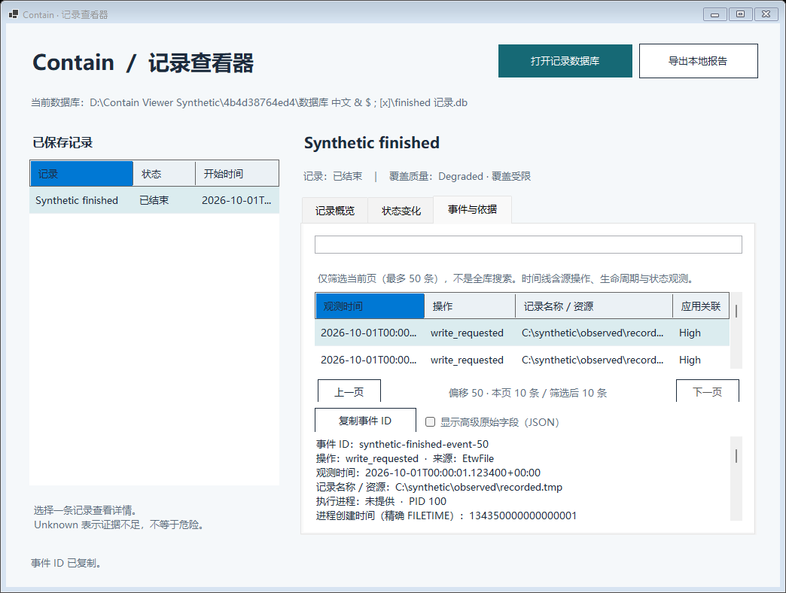

# Contain

**Record installation changes and inspect the evidence behind them.**

> Unknown is safer than a wrong answer.

## Which app changed this?

Contain v0.3.1 observes Windows installation sessions, links real events to verified process instances, and explains the evidence. **Contain distinguishes observed changes from attributed changes.**

Contain records evidence and offers a cleanup **dry run**. It does not guarantee zero leftovers or isolate an installer.

The [Windows desktop record viewer](desktop/README.md) opens an existing database,
lists saved records, shows state changes and paged source events, explains a
selected event and exports a local HTML report. It uses the packaged CLI and does
not start recording or an installer. Ordinary viewing needs no development tools.

## Current delivery status

Version remains **0.3.1**. The **bounded read-only candidate delivery** remains
closed for source `2ba98b6cbb99e2cf622ad45713fd8d38d9b76c15` and its original
controlled-ETW package. The **desktop record viewer MVP is now closed** for frozen
source `4b4d38764ed417e6754b5db798488227ec147e21` and the desktop package below.
These are separate bounded results, not release or general stability acceptance.

| User task | Implemented | Verified platform / scenario | Status and specific limit | Build / evidence |
| --- | --- | --- | --- | --- |
| Record controlled activity → save → reopen → explain | Existing native capture, SQLite, original JSON saving and CLI views | Prior Windows Server 2025 default and dual-clock fixtures: 35 product checks and 7 report commands each; saved/readback JSON identical | **Closed and retained.** Both records finished with Degraded coverage. No new capture in the desktop round | [Original core delivery](docs/read-only-workflow.md#verified-bounded-delivery), [original CLI ZIP](https://github.com/LuckyLivio/Contain/actions/runs/41102818151/artifacts/13000967787), source `2ba98b6` |
| Open an existing database without a terminal | Native WinForms picker, record list and overview; explicit read-only CLI; legacy compatibility in an in-memory copy | Windows Server 2025 x64, actual packaged CLI and controls; finished, historical/Unknown, interrupted and empty production-store synthetic databases | **Verified.** Missing, corrupt, unrelated and newer databases rejected; original database bytes unchanged | [Desktop CI 41122708670](https://github.com/LuckyLivio/Contain/actions/runs/41122708670), frozen source `4b4d387` |
| Browse changes and trace an event | Separate state/source views, bounded pages, current-page event filter, explain and ID copy | Actual 50/10 event paging, same-event JSON equality and clipboard; historical names and unavailable counters retained | **Verified.** Event filtering is page-local; old unindexed history can still require a full internal read | [Actual Windows screenshot](docs/examples/viewer-41122708670-event-explanation.png), [verification](docs/examples/windows-desktop-viewer-41122708670.json) |
| Export the selected record and event locally | Self-contained HTML from the same CLI; exact JSON, record/page/event identity checks, no upload | Actual export contains the selected record, current ten-event page and matching explain; reviewed public copy is byte-identical | **Verified.** Report contains the current unfiltered event page, not all history; local paths remain in user reports | [Actual synthetic HTML](docs/examples/viewer-41122708670-report.html), [viewer guide](desktop/README.md) |
| Download and double-click the desktop viewer | Windows x64 viewer, core CLI, self-contained .NET/MSVC runtime, three-record synthetic sample and identity manifests | Same frozen files in native launch/control tests and final ZIP; all 22 required desktop checks passed | **Desktop MVP closed.** Unsigned trial ZIP; clean Windows 10/11 manual compatibility remains untested | [Download desktop ZIP artifact](https://github.com/LuckyLivio/Contain/actions/runs/41122708670/artifacts/13010587633) |

Historical six clock questions remain D; formal provider/stabilization acceptance
is still unmet. Formal 32-attempt acceptance, scale validation, third-party
installers, final-state ownership and safe cleanup remain separate follow-up
scopes. None is implied by the desktop viewer. Graphical recording is not started.
The [failed desktop attempts](docs/examples/windows-desktop-viewer-attempts.json)
remain available alongside the successful result.

## Try the desktop viewer

[Download the Windows x64 desktop artifact](https://github.com/LuckyLivio/Contain/actions/runs/41122708670/artifacts/13010587633),
extract the complete contained ZIP, then double-click **Contain.Viewer.exe**.
No Rust, Visual Studio, Python or separately installed .NET is needed for viewing.
Choose **打开记录数据库**, select your database or the explicitly synthetic
`samples/viewer-demo.db`, select a record, then open **事件与依据** and click an
event. **导出本地报告** saves the current record/page/event to a new local HTML file.
The application never silently fills an empty database with sample records.



## Try the controlled CLI fixture

The Windows x64 CI trial package contains `contain.exe`, the controlled fixture,
required non-system runtime files, `BUILD.json`, `VALIDATION.json` and `TRY.md`.
Read its actual validation status before use: a diagnostic package is not a
verified candidate. Ordinary CLI use needs neither Rust nor Visual Studio.
The controlled demo additionally needs PowerShell 7 and Python 3.
From the extracted package, use a new output directory:

```powershell
pwsh -NoProfile -File .\scripts\demo.ps1 -RequireEtw -KeepArtifacts -OutputDirectory "$PWD\demo-result-new"
```

The prebuilt demo preserves its database and fixture and prints their locations.
It records a parent → child → grandchild fixture with an independent writer,
short-lived and detached helpers, rename/failure cases and registry noise;
then checks attribution, database reopening, JSON, paged views, event explanation
and unchanged data after dry-run. Files and registry changes stay within the
marked temporary fixture and its matching `HKCU\Software\Contain\Demo\*` key.
It creates no services, tasks or startup registrations.

For development from source, install Rust stable and Visual Studio C++ build
tools in addition to those demo tools. The original build entrypoint remains:

```powershell
./scripts/demo.ps1 -RequireEtw -KeepArtifacts
./scripts/demo.ps1 -SnapshotOnly -KeepArtifacts # explicit, separate fallback
```

ETW needs suitable Windows trace/provider permissions. Contain never opens UAC. With insufficient rights it continues with process observation and snapshots, and file/registry attribution remains `Unknown`. `-RequireEtw` is a test assertion, not an elevation request.

## Attribution reliability

v0.3 retains ETW process/thread lifetimes, distinguishes PID reuse, joins file
requests to completion where available, and explains actor, resource, operation
and application confidence separately. A SQLite evidence graph connects the
session, process instances, observations and resources.

The [verified fixture run](https://github.com/LuckyLivio/Contain/actions/runs/36542048919)
observed 20 of 21 instrumented operations: **17 correctly attributed, 4 Unknown,
0 incorrectly attributed, 0 application drops**. Unknown includes the unrelated
writer and a blocked deletion with no matching mutation event. This is fixture
coverage, not general accuracy. Both short-lived and post-installer-exit writes
were attributed. Registry context recovered some full paths; unresolved objects
still remain explicit. A later provider-readiness fix addresses asynchronous
startup. See [verification](docs/verification-v0.3.md) for the final tested revisions.

- [Actual terminal demo](docs/demo-output.txt)
- [Compatibility matrix](docs/windows-compatibility.md)
- [Reproducible 10,000-file benchmark](docs/performance.md)

## Use the CLI

```powershell
cargo build --workspace --locked
./target/debug/contain.exe doctor
./target/debug/contain.exe install .\SomeAppSetup.exe --name SomeApp --watch "$env:LOCALAPPDATA\SomeApp" --registry-key Software\Vendor\SomeApp
./target/debug/contain.exe inspect SomeApp
./target/debug/contain.exe inspect SomeApp --verbose
./target/debug/contain.exe explain <event-id> --json
./target/debug/contain.exe diff SomeApp
./target/debug/contain.exe history SomeApp --json
./target/debug/contain.exe remove SomeApp --dry-run
```

Watch directories must already exist. Repeat `--watch` for each scope. Without it only the installer's directory is watched. `--registry-key` selects one HKCU Software key: values are compared at that key; ETW may also observe operations beneath it. Installer arguments follow `--`. Use `--no-etw` to disable tracing. After root exit, `--settle-ms` (default 1500) sets the quiet period and `--max-drain-ms` (default 10000) bounds waiting for descendants/activity. A timeout marks the session Incomplete.

`--db <path>` selects a database; default is `%LOCALAPPDATA%\Contain\contain.db`. `list --json`, `inspect --json`, `diff --json`, `history --json`, and `doctor --json` use a [versioned JSON contract](docs/json-contract.md). `install --manifest <path>` exports an inspect document. FILETIME identity fields use decimal strings to preserve full precision.

v0.3.1 continuously commits a bounded raw evidence journal, then finalizes evidence
in pages. Keep the database outside watched roots. `--evidence-quota-mib` defaults
to 256; quota/write failures remain visible. Interrupted sessions are explicitly
unfinished and expose no final attribution. `history <app> --json --limit 256
--offset 0` reads a page; default inspect reads a summary. See the
[pipeline ADR](docs/adr/0006-capture-pipeline.md) and [counter definitions](docs/capture-counters.md).

The current release comparison passes 100 files / four workers in three trials.
1000 and 10000 files fail the useful-attribution gate; 1000 is a regression against
the baseline. This remains experimental. See the [measured limits](docs/performance.md#final-measured-decision-2026-09-29).

Opt-in development experiments are tracked separately in the
[commit-window diagnostics](docs/capture-commit-tail.md) and
[deferred checkpoint report](docs/capture-deferred-checkpoint.md).

The [v0.4 development report](docs/validation-v0.4.md) records measured readback
optimizations and attribution fixes. Release gates remain unmet; the package is
still 0.3.1. The stabilization candidate separates receiving from SQLite and
observes final resources while tracing. The administrator-run small ETW demo is
now archived; it does not replace the 1,000/10,000-file acceptance runs. Controlled
tests found that retained file read leases blocked legitimate operations, so the
current candidate uses shared reads without retaining those restrictive handles.
These reads are not a global atomic snapshot. Uncovered mutations and registry read races
still prevent final-state ownership claims. Valid source actor evidence remains
separate. The stabilization milestone is not yet accepted by live ETW validation.

## What v0.3 records

| Source | Recorded evidence | Attribution boundary |
| --- | --- | --- |
| Owned handle, ETW process/thread lifetimes and polling | PID, creation time, executable, verified parent chain | Installer Certain; observed descendants High |
| ETW Kernel-File | Scoped create/write/rename/delete observations, timestamp, issuing thread → retained or live process identity, object generations and IRP completion | High only for a matching installer-family instance |
| ETW Kernel-Registry | Scoped key/value operations, completion status when available, writer identity when queryable | Unknown unless the same lifetime/ancestry checks pass |
| File hash and HKCU snapshots | Before/after state, including modified/deleted entries | Unknown alone; correlated event evidence is separate |
| Service, scheduled task, startup inventories | Created/changed/removed configuration with before/after fields | Exact verified executable target can be Medium; timing alone stays Unknown |

Inspect summarizes capture quality and counters; `--verbose` and `explain` show evidence details. Diff groups attributed and unattributed changes. History distinguishes source event times from end-of-session state observations. A successful operation, an attributed process, and a surviving state change are separate facts.

## Safety and privacy

- `remove` requires `--dry-run`; there is no deletion executor, uninstaller execution, or rollback.
- User data stays `USER_DATA`. A High-attributed cache may be `REVIEW`; unknown or changed files remain `UNKNOWN`. Nothing is marked `SAFE` for deletion.
- No automatic elevation, driver, service installation, Defender changes or automated classification. The desktop interface only views existing records and exports local reports.
- No account, telemetry, or uploads in the application. Databases/manifests contain local paths and possibly registry/configuration data; review them before sharing.
- ETW providers produce system-wide activity; scoped records and verified installer lifecycle/unresolved-object evidence are retained; other resources are discarded. The scanner skips reparse points. Contain does not sandbox the installer you launch.

## Limitations

- File source confidence identifies an execution actor and recorded name, not an
  explicit application API call, verified current path or final content owner.
  Ordinary capture retains provider/cache name provenance and its observation
  time; a historical cached name is labelled as such. Older records without this
  evidence remain readable with provenance unavailable.

- Missing lifecycle events, ambiguous lifetimes, provider access failure or unsupported schemas reduce coverage. Captures are Degraded or Incomplete; v0.3 never claims a complete footprint.
- Normalized operations preserve raw references. IRP completion is partial; stable file IDs prove surviving rename/replacement endpoints, not an entire transient chain or exclusive ownership.
- Registry context requires a verified absolute base and the same process lifetime. Missing paths stay `<unresolved registry object>`. Registry snapshots remain Unknown when complete scoped writer evidence is unavailable.
- Drain is finite. Broker/service-manager activity and changes after the session are not automatically descendants.
- Services, tasks and Run entries are read-only inventories. Their actual writer and mutation time are unknown. Protected inventories produce warnings, not inferred removals.
- Captures have bounded queues/caches, visible drops and separate ETW event/buffer loss. Reported loss suppresses application promotion; no-loss counters do not prove provider coverage.

## Development

```powershell
cargo fmt --all -- --check
cargo clippy --workspace --all-targets -- -D warnings
cargo test --workspace
cargo build --workspace --locked
./scripts/demo.ps1
```

Windows CI keeps real ETW and fallback integration separate from the desktop
existing-records plan. Desktop validation runs the required quality gates and
native UI/CLI checks without recording new activity. Read the
[architecture](docs/architecture.md), [backend ADR](docs/adr/0001-event-attribution-backend.md),
[contribution guide](CONTRIBUTING.md), [security policy](SECURITY.md), and
[code of conduct](CODE_OF_CONDUCT.md).

The next stabilization matrix is **preregistered, not executed**. With frozen
baseline/candidate executables, one common fixture and their full source revisions,
this command plans 32 real-ETW attempts (three pairs at 100/10000, ten at 1000):

```powershell
python scripts/v04-matrix.py --stabilization --baseline $baselineExe --candidate $candidateExe --fixture $commonFixtureExe --baseline-revision $baselineRevision --candidate-revision $candidateRevision --output target/v04/stabilization-etw --files 100 1000 10000 --workers 4 --trials 3 --stability-trials 10 --noise-files 100
```

The [protocol](docs/v04-validation.md) retains the original scores separately.
Its new gate remains blocked until original ETW QPC and provider timing rules are
independently validated; fallback or a clock diagnostic cannot count as a pass.

Graphical recording and real-installer trials are separate follow-up work. The
current desktop scope ends at viewing existing records and exporting reports;
real cleanup remains unimplemented.

## License

Apache-2.0. See [LICENSE](LICENSE).
