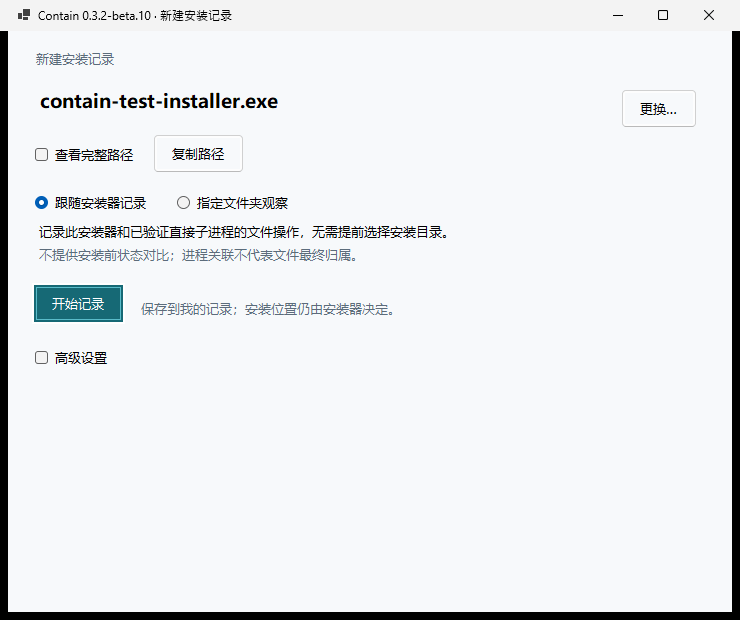
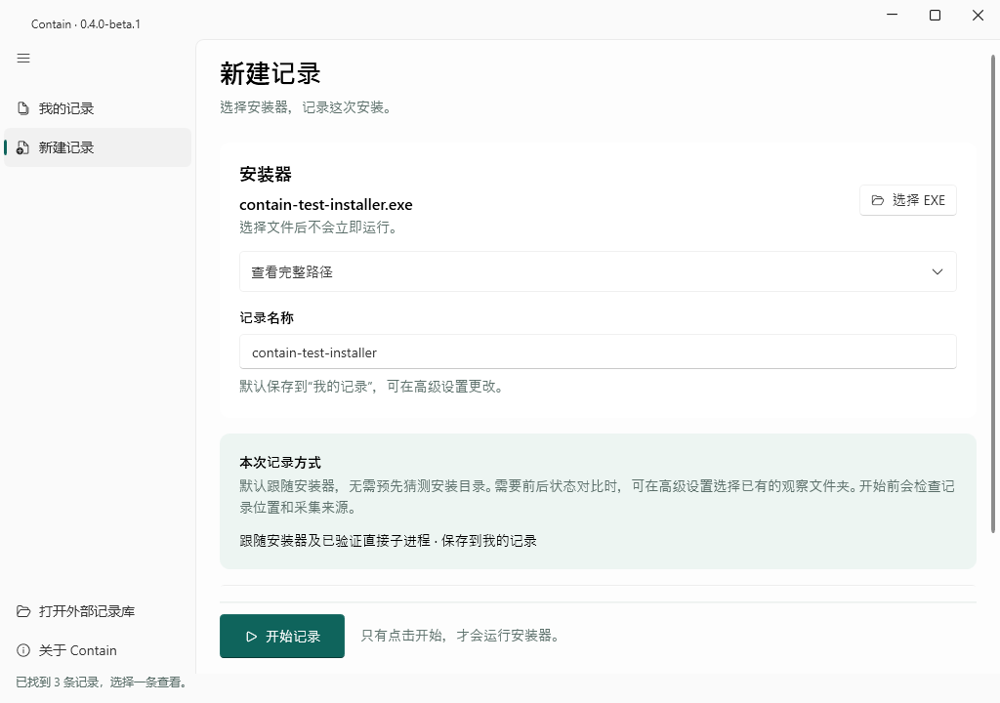
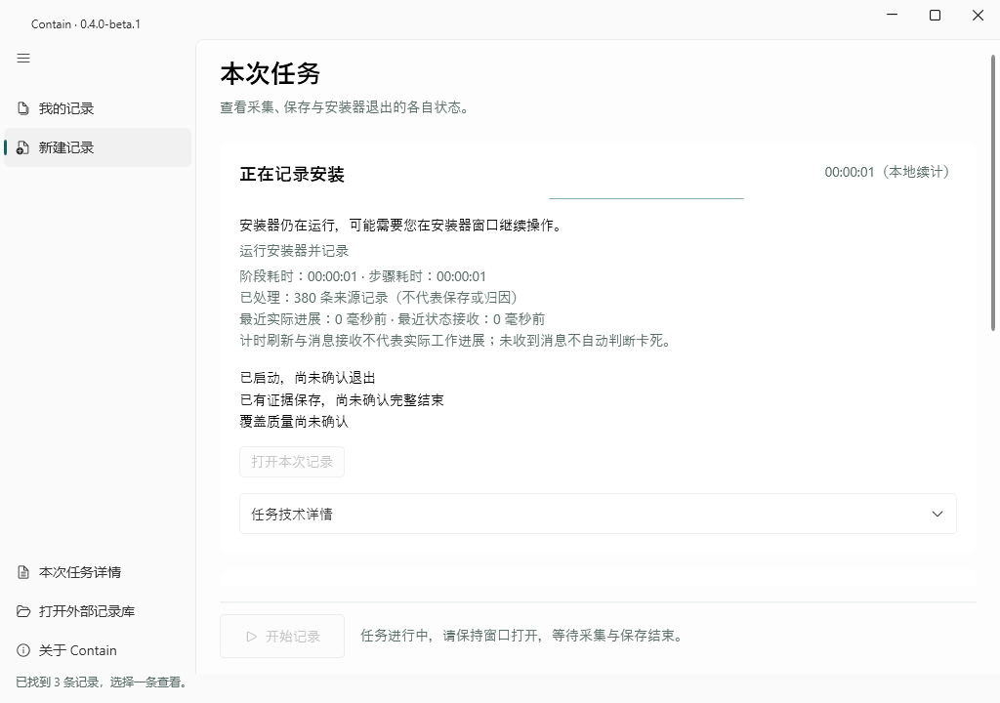
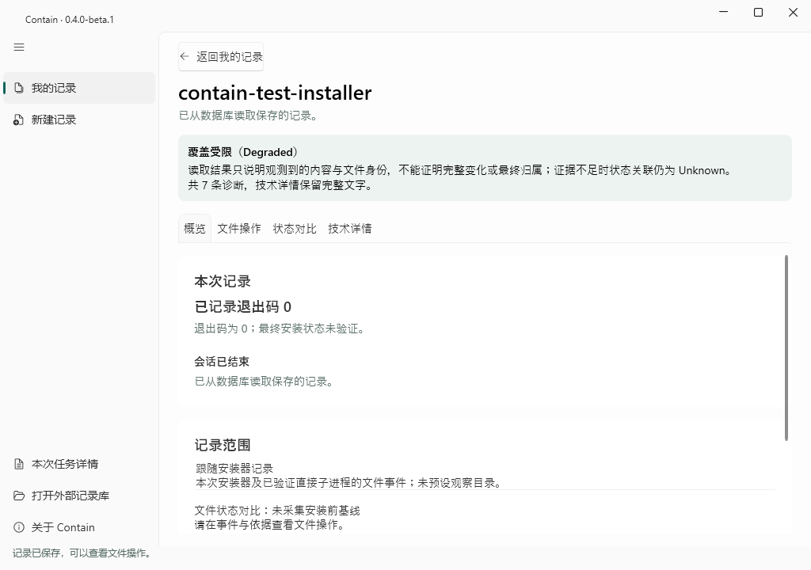
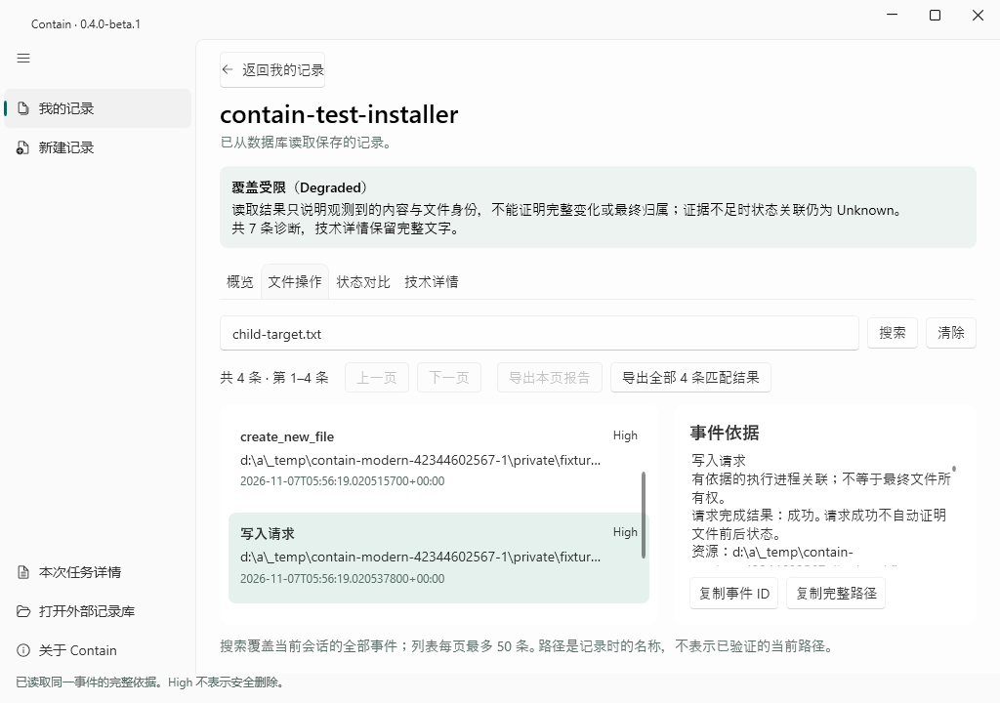

# v0.4.0-beta.1 实际 Windows 截图

以下 13 张图片来自最终原包的 [M13 原生验收](https://github.com/LuckyLivio/Contain/actions/runs/42344602567)，不是设计稿。
源码 `5a6ce89867e4c8c9d428de0a80b67b421bbd9717`，Windows Server 2025 x64 / 10.0.26100，实测 96 DPI。
文件按验收报告 SHA-256 原样归档；未裁剪、放大、重绘或替换数据。未声称高 DPI、Parallels 或多显示器验证。

| 画面 | 原始像素 / 实测 DPI | 数据来源 |
| --- | --- | --- |
| [首次空库（隔离测试目录）](images/beta04/records-empty.png) | 1024×720 / 96 | `isolated-empty` |
| [我的记录（合成同名记录）](images/beta04/records-sample.png) | 1024×720 / 96 | `synthetic-viewer-fixtures` |
| [已结束但非零退出 / Incomplete 合成记录](images/beta04/overview-finished.png) | 1024×720 / 96 | `synthetic-persisted-outcome` |
| [缺少退出信息的合成历史记录](images/beta04/overview-historical.png) | 1024×720 / 96 | `synthetic-persisted-outcome` |
| [未完成的合成记录](images/beta04/overview-interrupted.png) | 1024×720 / 96 | `synthetic-persisted-outcome` |
| [130 / 53 合成搜索与解释](images/beta04/events-search-explain.png) | 1024×720 / 96 | `synthetic-130-events-53-matches` |
| [紧凑事件页（合成记录）](images/beta04/compact-events.png) | 820×640 / 96 | `synthetic-viewer-fixtures` |
| [紧凑新建页（未启动安装）](images/beta04/compact-new-record.png) | 820×640 / 96 | `isolated-configuration-no-install` |
| [真实夹具配置，明确开始之前](images/beta04/new-record-configured.png) | 1024×720 / 96 | `real-controlled-fixture-before-explicit-start` |
| [真实 ETW 采集中的任务状态](images/beta04/task-real-recording.png) | 1024×720 / 96 | `real-controlled-etw-capture` |
| [真实保存后的概览](images/beta04/real-saved-overview.png) | 1024×720 / 96 | `real-controlled-etw-saved` |
| [真实子进程写入解释](images/beta04/real-event-explanation.png) | 1024×720 / 96 | `real-controlled-etw-saved` |
| [不同目录冷启动后的同一真实事件](images/beta04/real-cold-restart.png) | 1024×720 / 96 | `real-controlled-etw-saved-cold-restart` |

## 改版前后：同为真实窗口，不同原始尺寸

Beta.10 WinForms：740×620、96 DPI，来自已发布的 [install-record-after.png](https://github.com/LuckyLivio/Contain/releases/download/v0.3.2-beta.10/install-record-after.png)，
SHA-256 `95ef6b7f0d59ac52086248cba50df5fd5f8d538c995e60c192aeece1e04f6063`。
旧包产品源码 `b0d2510db34cdf6630d2d550b69ccdbfe6da3fd4`；受控夹具配置。

Beta.1 WPF：1024×720、96 DPI，M13 真实夹具配置，尚未点击开始。
增加常驻导航、记录名称与清晰的默认保存说明，主要开始操作固定于底部。

## 运行和保存后的实际界面

任务阶段、耗时、测量、退出和保存分别显示，技术原文折叠保留。

检查结果：三页主题与间距一致；空态有创建入口；同名记录可区分；搜索、分页、导出与复制固定可见；紧凑窗口可滚动，键盘焦点可见。
长路径省略显示且可复制完整内容；缺失值、非零退出、未完成及 Incomplete 保持原义。
所有截图已逐张实际查看。范围仅限上述尺寸与 96 DPI。
