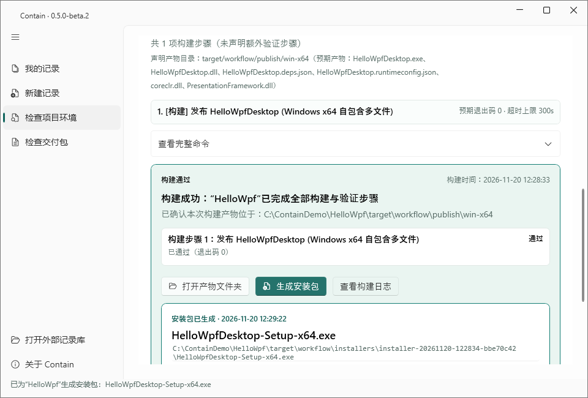

# Contain v0.5.0-beta.3 首次打包实测

首次打开 Contain 即可选择项目文件夹。识别时读取工程信息，保存配置前显示写入说明，构建前显示将要执行的操作。已有个人记录库的用户仍从“我的记录”进入，侧栏的“打包项目”可以随时打开。

## 操作次数和界面

统计范围从产品窗口就绪到界面显示第一个 Setup。文件夹选择框中的点击、路径输入和按键均已计入。打开结果文件夹及生成物安装验收位于统计区间之后。

| 实测指标 | v0.5.0-beta.2 · WPF | v0.5.0-beta.3 · WPF | WPF 变化 | v0.5.0-beta.3 · 控制台缺 Inno 后恢复 |
|---|---:|---:|---:|---:|
| 操作步骤 | 6 | 3 | -3 | 4 |
| 鼠标点击 | 8 | 5 | -3 | 6 |
| 键盘操作 | 3 | 3 | 0 | 3 |
| 文件夹路径输入 | 1 | 1 | 0 | 1 |
| 整页滚动 | 3 | 0 | -3 | 0 |
| 产品页面切换 | 1 | 0 | -1 | 0 |

两次 WPF 走查均使用 .NET 10 模板项目 `HelloWpf`、自定义程序集 `HelloWpfDesktop` 和入口 `HelloWpfDesktop.exe`。两份回执均记录了从开始菜单启动后响应的 `MainWindow` 和卸载通过。

控制台走查使用 `HelloConsoleDesktop.exe`。该作业将 Contain 配置的编译器路径指向不存在的 ISCC.exe，触发真实的缺项提示。在该路径补齐 Inno Setup 6 后，通过同一窗口重新检测并打包，核对生成的 Setup 与入口文件散列。三条路径均在生成 Setup 后多点击一次打开目录，已核对资源管理器显示的完整路径。

| 场景 | Windows 验收 | 构建映像 | 生成的项目 Setup SHA-256 |
|---|---|---|---|
| v0.5.0-beta.2 WPF | [运行 44735848078，第 1 次](https://github.com/LuckyLivio/Contain/actions/runs/44735848078/attempts/1) | win22 20261116.370.1 / Windows 10.0.20348.0 | `1f6c478f42d776a51d802f7772a3f49e36cd186c878a6543d9d2decedfad2c90` |
| v0.5.0-beta.3 WPF | [运行 44735848240，第 1 次](https://github.com/LuckyLivio/Contain/actions/runs/44735848240/attempts/1) | win22 20261116.370.1 / Windows 10.0.20348.0 | `1de28238e42318a1eccd881355f19e44fb2ea1d3539198717104b28ac24dbb8b` |
| v0.5.0-beta.3 控制台恢复 | [运行 44735848240，第 1 次](https://github.com/LuckyLivio/Contain/actions/runs/44735848240/attempts/1) | win22 20261116.370.1 / Windows 10.0.20348.0 | `ce01918639384eb570be1b7d63195376b14c04dcd9645ec9bebac0710322c814` |

v0.5.0-beta.2 产品源码 `18782fc4e8cfd91df4d60fa339b77070236f130a`，Setup `4f0bd9aa89507f69e90ded3356e1c7531a4025a85b4ffbb7a662fb6ff58e7c6f`，验收工作流 `0e6f2db8f39420481b24fd1781f1cacc9400d9bd`。

v0.5.0-beta.3 产品源码 `d898f31b39ac333a1f973bb08ab70610bc35c4ad`，Setup `5f78f3ae3fcb20861b3e062fec997a332ad95fa1ef99f474b8f750bd9ba4cfce`，验收工作流 `0e6f2db8f39420481b24fd1781f1cacc9400d9bd`。恢复的 Inno 编译器 SHA-256 为 `0a8757031b33777e4c9cbffee40f11a5062b36d25cbe144c1db73b6102b80ad7`。

已逐张校对 10 张截图的 PNG 字节、SHA-256 和 960 × 650 尺寸，DPI 为 96。[原版操作明细与截图摘要](first-package-v0.5.0-beta.3/v0.5.0-beta.2-measurement.json) · [新版 WPF 走查原件](https://github.com/LuckyLivio/Contain/releases/download/v0.5.0-beta.3/first-package-wpf.zip)

| 实测页面 | v0.5.0-beta.2 | v0.5.0-beta.3 |
| --- | --- | --- |
| 首次打开 |  |  |
| 选择项目后 |  |  |
| 生成安装包后 |  |  |

缺少 Inno Setup 时，界面说明如何取得编译器以及补齐后从哪里继续。恢复检测后，在同一个项目继续打包。[查看缺工具时的窗口](first-package-v0.5.0-beta.3/missing-inno.png)

## 安装与升级

常规安装作业使用 GitHub 托管 Windows Server 2022 x64，系统版本 `10.0.20348.0`，镜像 `20261112.366.7`。使用准备发布的同一个 Contain Setup 安装、核对版本、打开窗口、读取合成记录并标准卸载。便携版和独立 CLI 的包规格、入口和校验值均经验证。从公开 v0.5.0-beta.2 原位升级后可继续读取原有记录。干净无开发工具机器和完全断网试装留待稳定版前验证。[验收任务](https://github.com/LuckyLivio/Contain/actions/runs/44735848240) · [升级收据](https://github.com/LuckyLivio/Contain/releases/download/v0.5.0-beta.3/prerelease-upgrade.json)

| 交付 | SHA-256 |
| --- | --- |
| [Contain-Setup-x64.exe](https://github.com/LuckyLivio/Contain/releases/download/v0.5.0-beta.3/Contain-Setup-x64.exe) | `5f78f3ae3fcb20861b3e062fec997a332ad95fa1ef99f474b8f750bd9ba4cfce` |
| [contain-0.5.0-beta.3-windows-x64.zip](https://github.com/LuckyLivio/Contain/releases/download/v0.5.0-beta.3/contain-0.5.0-beta.3-windows-x64.zip) | `4f8ff7e9d2e2a954bdab0ae9103f7c2b6de00870f9bd09ba7e8e6d58a5f4b462` |
| [contain-workflow-0.5.0-beta.3-windows-x64.zip](https://github.com/LuckyLivio/Contain/releases/download/v0.5.0-beta.3/contain-workflow-0.5.0-beta.3-windows-x64.zip) | `832db170db4ecc6cd36bdf8d92cb588bd8d1e576e82ec3c161992f82b7b53e58` |
| [SHA256SUMS.txt](https://github.com/LuckyLivio/Contain/releases/download/v0.5.0-beta.3/SHA256SUMS.txt) | `baee24c0c64db3a80d3ef0013574c99b4ae0de80b2dfed3f69c3a28b81711422` |
| [first-package-wpf.zip](https://github.com/LuckyLivio/Contain/releases/download/v0.5.0-beta.3/first-package-wpf.zip) | `d0b7c19f0dd38761cbe7182713101839acedba97e194740ae3b2e93bab3590df` |
| [first-package-missing-inno.zip](https://github.com/LuckyLivio/Contain/releases/download/v0.5.0-beta.3/first-package-missing-inno.zip) | `0f2c79f831dc856a1aa57c4d096d1597b8198d881ccb0c8bb6fc4c8dd3d2e97c` |

产品源码为 `d898f31b39ac333a1f973bb08ab70610bc35c4ad`，Windows 构建工作流提交为 `4f2582d4242ea6fbec13b3ed59af3a33917c3599`，验收工作流提交为 `0e6f2db8f39420481b24fd1781f1cacc9400d9bd`。[基线走查](https://github.com/LuckyLivio/Contain/actions/runs/44735848078) · [源码](https://github.com/LuckyLivio/Contain/commit/d898f31b39ac333a1f973bb08ab70610bc35c4ad) · [候选构建](https://github.com/LuckyLivio/Contain/actions/runs/44734441798) · [PR #28](https://github.com/LuckyLivio/Contain/pull/28)

### 早期走查

原版第一次走查在记录首张窗口截图时中止。调整窗口尺寸后重新测量并取得上表结果。候选第一次走查已通过常规安装与升级，三个界面作业在识别新版选文件夹对话框标题时中止。验收脚本随后按实际版本核对对话框标题。后续走查显示长路径将结果按钮挤到了窗口下缘。将文件名和打开目录按钮移到同一处、把路径收进详情后，重新冻结并构建候选。[首次截图尝试](https://github.com/LuckyLivio/Contain/actions/runs/44730713545) · [首次候选走查](https://github.com/LuckyLivio/Contain/actions/runs/44732473426) · [打开目录检查的早期尝试](https://github.com/LuckyLivio/Contain/actions/runs/44732889774) · [结果页调整依据](https://github.com/LuckyLivio/Contain/actions/runs/44733741939)
