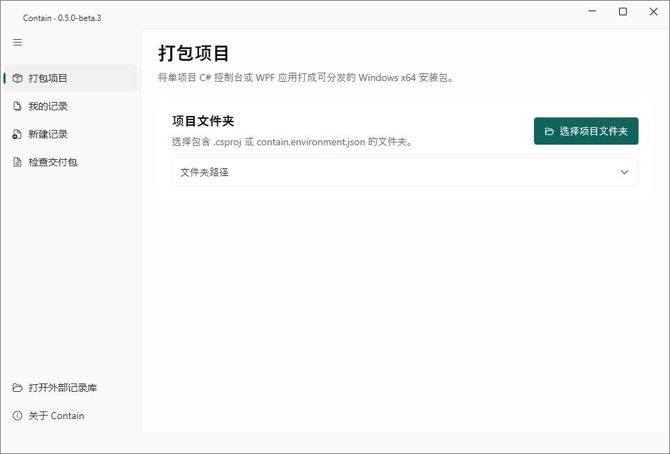
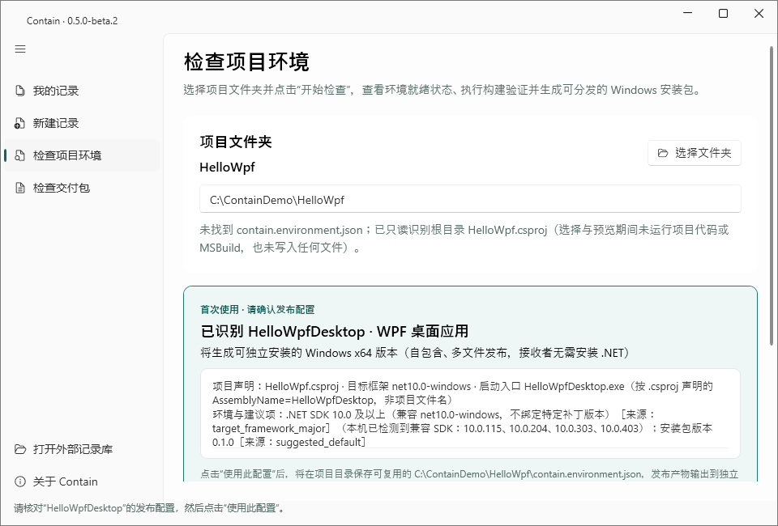
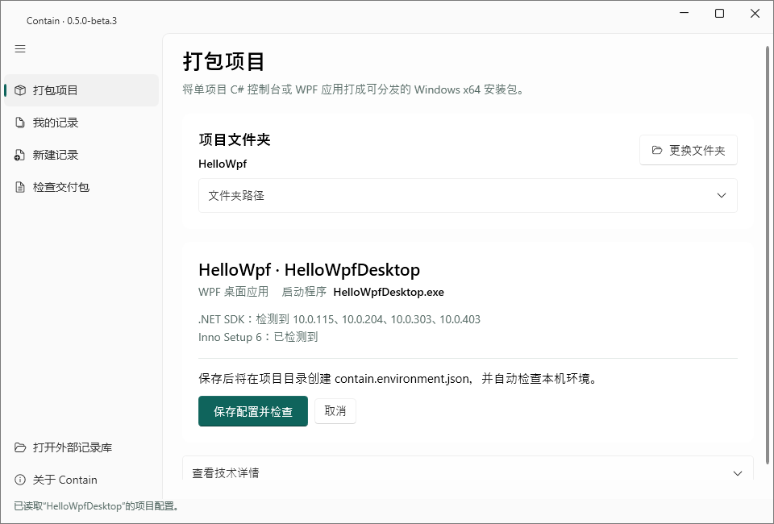
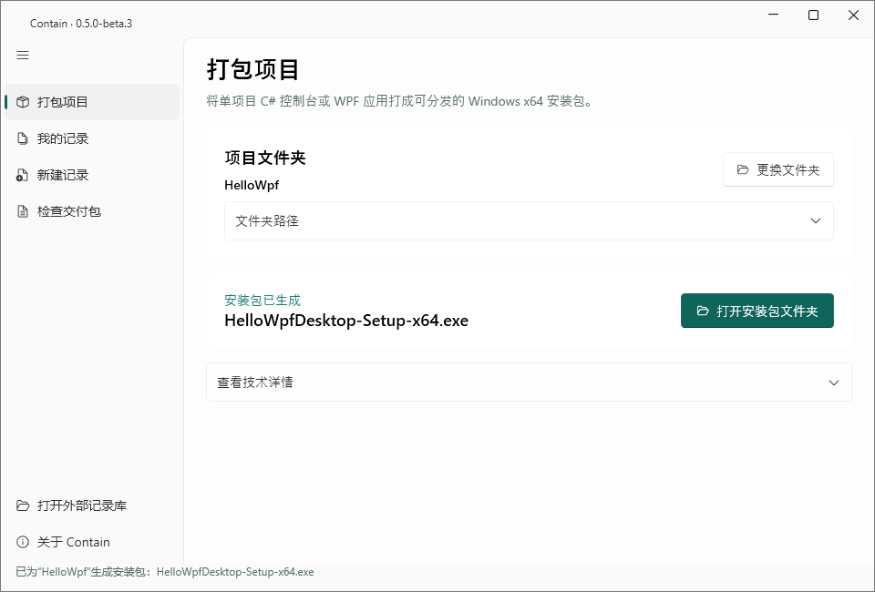

# Contain v0.5.0-beta.3 首次打包实测

首次打开 Contain 即可选择项目文件夹。识别时读取工程信息，保存配置前显示写入说明，构建前显示将要执行的操作。已有个人记录库的用户仍从“我的记录”进入，侧栏的“打包项目”可以随时打开。

## 操作次数和界面

统计范围从产品窗口就绪到界面显示第一个 Setup。文件夹选择框中的点击、路径输入和按键均已计入。打开结果文件夹及生成物安装验收位于统计区间之后。

| 实测指标 | v0.5.0-beta.2 · WPF | v0.5.0-beta.3 · WPF | WPF 变化 | v0.5.0-beta.3 · 控制台缺 Inno 后恢复 |
|---|---:|---:|---:|---:|
| 操作步骤 | 6 | 3 | -3 | 4 |
| 鼠标点击 | 8 | 5 | -3 | 6 |
| 键盘操作 | 3 | 3 | 0 | 3 |
| 文件夹路径输入 | 1 | 1 | 0 | 1 |
| 整页滚动 | 3 | 0 | -3 | 0 |
| 产品页面切换 | 1 | 0 | -1 | 0 |

两次 WPF 走查均使用 .NET 10 模板项目 `HelloWpf`、自定义程序集 `HelloWpfDesktop` 和入口 `HelloWpfDesktop.exe`。两份回执均记录了从开始菜单启动后响应的 `MainWindow` 和卸载通过。

控制台走查使用 `HelloConsoleDesktop.exe`。该作业将 Contain 配置的编译器路径指向不存在的 ISCC.exe，触发真实的缺项提示。在该路径补齐 Inno Setup 6 后，通过同一窗口重新检测并打包，核对生成的 Setup 与入口文件散列。三条路径均在生成 Setup 后多点击一次打开目录，已核对资源管理器显示的完整路径。

| 场景 | Windows 验收 | 构建映像 | 生成的项目 Setup SHA-256 |
|---|---|---|---|
| v0.5.0-beta.2 WPF | [运行 44735848078，第 1 次](https://github.com/LuckyLivio/Contain/actions/runs/44735848078/attempts/1) | win22 20261116.370.1 / Windows 10.0.20348.0 | `1f6c478f42d776a51d802f7772a3f49e36cd186c878a6543d9d2decedfad2c90` |
| v0.5.0-beta.3 WPF | [运行 44735848240，第 1 次](https://github.com/LuckyLivio/Contain/actions/runs/44735848240/attempts/1) | win22 20261116.370.1 / Windows 10.0.20348.0 | `1de28238e42318a1eccd881355f19e44fb2ea1d3539198717104b28ac24dbb8b` |
| v0.5.0-beta.3 控制台恢复 | [运行 44735848240，第 1 次](https://github.com/LuckyLivio/Contain/actions/runs/44735848240/attempts/1) | win22 20261116.370.1 / Windows 10.0.20348.0 | `ce01918639384eb570be1b7d63195376b14c04dcd9645ec9bebac0710322c814` |

v0.5.0-beta.2 产品源码 `18782fc4e8cfd91df4d60fa339b77070236f130a`，Setup `4f0bd9aa89507f69e90ded3356e1c7531a4025a85b4ffbb7a662fb6ff58e7c6f`，验收工作流 `0e6f2db8f39420481b24fd1781f1cacc9400d9bd`。

v0.5.0-beta.3 产品源码 `d898f31b39ac333a1f973bb08ab70610bc35c4ad`，Setup `5f78f3ae3fcb20861b3e062fec997a332ad95fa1ef99f474b8f750bd9ba4cfce`，验收工作流 `0e6f2db8f39420481b24fd1781f1cacc9400d9bd`。恢复的 Inno 编译器 SHA-256 为 `0a8757031b33777e4c9cbffee40f11a5062b36d25cbe144c1db73b6102b80ad7`。

已逐张校对 10 张截图的 PNG 字节、SHA-256 和 960 × 650 尺寸，DPI 为 96。[原版操作明细与截图摘要](first-package-v0.5.0-beta.3/v0.5.0-beta.2-measurement.json) · [新版 WPF 走查原件](https://github.com/LuckyLivio/Contain/releases/download/v0.5.0-beta.3/first-package-wpf.zip)

| 实测页面 | v0.5.0-beta.2 | v0.5.0-beta.3 |
| --- | --- | --- |
| 首次打开 |  |  |
| 选择项目后 |  |  |
| 生成安装包后 |  |  |

缺少 Inno Setup 时，界面说明如何取得编译器以及补齐后从哪里继续。恢复检测后，在同一个项目继续打包。[查看缺工具时的窗口](first-package-v0.5.0-beta.3/missing-inno.png)

## 安装与升级

常规安装作业使用 GitHub 托管 Windows Server 2022 x64，系统版本 `10.0.20348.0`，镜像 `20261112.366.7`。使用准备发布的同一个 Contain Setup 安装、核对版本、打开窗口、读取合成记录并标准卸载。便携版和独立 CLI 的包规格、入口和校验值均经验证。从公开 v0.5.0-beta.2 原位升级后可继续读取原有记录。[验收任务](https://github.com/LuckyLivio/Contain/actions/runs/44735848240) · [升级收据](https://github.com/LuckyLivio/Contain/releases/download/v0.5.0-beta.3/prerelease-upgrade.json)

## 干净无开发工具、完全断网接收机实测（Windows 11 x64 沙箱）

以下两项实测均在独立的 **Windows 11 企业版 x64（`10.0.26100`）禁网沙箱**中完成（`<Networking>Disable</Networking>`，`network_offline = true`，活跃物理网卡 `0`；未安装现代 `.NET` 运行时／SDK、Rust、Cargo、Python、Git、Visual Studio 与 Inno Setup，系统自带 `.NET Framework 4.8.09032` 单列），原始本机运行日志留在本地，以下链接为脱敏公开收据：

1. **Contain 本身可离线安装（通过）** — [断网接收收据](first-package-v0.5.0-beta.3/offline-contain-setup-receiver.json)
   - **受测版本与对象**：从公开 GitHub Release `v0.5.0-beta.3`（产品源码 `d898f31b39ac333a1f973bb08ab70610bc35c4ad`）下载并对照 `SHA256SUMS.txt` 复核的 `Contain-Setup-x64.exe`（`51,349,435` 字节，SHA-256 `5f78f3ae3fcb20861b3e062fec997a332ad95fa1ef99f474b8f750bd9ba4cfce`）。
   - **实测路径**：单文件拷入沙箱安装（退出码 `0`），HKCU 卸载登记唯一 `Contain` 条目（`0.5.0-beta.3`）；从开始菜单 `Contain.lnk` 启动主窗口 `Contain · 0.5.0-beta.3`，首次打开默认进入 **`打包项目`** 页（「选择项目文件夹」按钮可用）；通过「打开外部记录库」加载随包 `samples\viewer-demo.db`，浏览 `synthetic-finished` 并选中 `event:synthetic-finished-event-0`（`C:\synthetic\observed\recorded.tmp`），右侧完整读出精确 FILETIME `134350000000000001` 与关联依据；随包 `contain-workflow.exe --version`（`0.5.0-beta.3`）与 `contain.exe --version`（`0.3.2-beta.10`）均正常退出 `0`；随后正常关闭（退出码 `0`）并执行标准卸载（退出码 `0`）。
   - **卸载与残留核实**：卸载登记归零（`0`）、开始菜单 `Contain.lnk` 已删除、`Contain.Viewer.exe` 等全部已安装文件已删除、`%LOCALAPPDATA%\Contain` 未创建。因直接在 `{app}\samples\` 目录内打开 WAL 模式的 `viewer-demo.db`，运行期生成的 2 个 SQLite 侧车文件 `samples\viewer-demo.db-shm` 与 `samples\viewer-demo.db-wal` 按 Inno Setup 不删除安装后新建文件的安全策略留在 `samples\` 子目录中。

2. **Contain 生成的 WPF 应用可离线交付（通过）** — [生成应用断网接收收据](first-package-v0.5.0-beta.3/offline-wpf-app-receiver.json)
   - **制作过程（公开 Beta.3 桌面端）**：在 Windows 11 x64 开发机安装上述公开 `v0.5.0-beta.3` 安装包（核实安装后 `Contain.Viewer.exe` SHA-256 `9c270f48de45b76d3ef27f714111eb15d361b79171e278651a45d146202d02af`、`contain-workflow.exe` SHA-256 `b0e148f28f9d42521b7790aa097892ff5f1a029aede85a7670a85d2d5cc18726`），对带自定义 `<AssemblyName>HelloWpfDesktop</AssemblyName>` 且包含可交互按钮的 .NET 10 单项目 WPF 样例 `HelloWpf`，完整走完「选择项目文件夹 → 保存配置并检查 → 构建并生成安装包 → 打开安装包文件夹」（原 `HelloWpf.csproj` 全程未改动），生成 `HelloWpfDesktop-Setup-x64.exe`（`46,158,147` 字节，未签名 `NotSigned`，`AppId {346fc570-f5e8-4b6b-b6cb-f9f99ece8302}`，SHA-256 `f539ecd22eeb0aff59547a7db3a3253aabe2ac73612e5f43c742e64424f65045`，入口 `HelloWpfDesktop.exe` SHA-256 `26b7eef494f505e34c5b30791824e528832efda8fe4ab48877d450bbbcb8be5a`）。因历史 CI 未归档其临时生成的演示 EXE，本次生成物按自身独立哈希验收。
   - **单文件离线接收验证**：仅将 `HelloWpfDesktop-Setup-x64.exe` 单文件（不带项目源码、发布目录或开发机运行库）只读映射入全新禁网无工具沙箱（未安装 Contain，也无任何现代 `.NET` 目录或命令），核对复制前后 SHA-256 均为 `f539ecd22eeb0aff59547a7db3a3253aabe2ac73612e5f43c742e64424f65045`。静默安装（退出码 `0`）后核实 HKCU 卸载登记 `HelloWpfDesktop (346fc570)`（`0.1.0`）、开始菜单快捷方式 `HelloWpfDesktop (346fc570).lnk` 指向已核验的 `HelloWpfDesktop.exe` 且包含自包含 `PresentationFramework.dll`；从开始菜单启动后显示 `HelloWpfDesktop` 主窗口，点击交互按钮 `VerifyActionButton` 后状态文本由 `Ready` 实时更新为 `Verified click #1`，随后正常关闭（退出码 `0`）并执行标准卸载（退出码 `0`），卸载登记、开始菜单快捷方式与安装目录全部清除（`remaining_items = []`，零残留）。

3. **单独记账范围**：上述两项验证证明了公开 `v0.5.0-beta.3` 的单文件安装包本身及其生成的自包含 WPF 安装包均可在干净无开发工具的断网 Windows x64 接收机独立安装、运行与卸载；按 [第一阶段说明](phase-one.md) 要求的完整 **“干净源码机 A（`-Stage SourceMissing` → 补齐工具 → `-Stage Source`）→ 第二台干净接收机 B（`-Stage Package`）”** 链路仍单列记账，尚未对 `d898f31b` 执行。

| 交付 | SHA-256 |
| --- | --- |
| [Contain-Setup-x64.exe](https://github.com/LuckyLivio/Contain/releases/download/v0.5.0-beta.3/Contain-Setup-x64.exe) | `5f78f3ae3fcb20861b3e062fec997a332ad95fa1ef99f474b8f750bd9ba4cfce` |
| [contain-0.5.0-beta.3-windows-x64.zip](https://github.com/LuckyLivio/Contain/releases/download/v0.5.0-beta.3/contain-0.5.0-beta.3-windows-x64.zip) | `4f8ff7e9d2e2a954bdab0ae9103f7c2b6de00870f9bd09ba7e8e6d58a5f4b462` |
| [contain-workflow-0.5.0-beta.3-windows-x64.zip](https://github.com/LuckyLivio/Contain/releases/download/v0.5.0-beta.3/contain-workflow-0.5.0-beta.3-windows-x64.zip) | `832db170db4ecc6cd36bdf8d92cb588bd8d1e576e82ec3c161992f82b7b53e58` |
| [SHA256SUMS.txt](https://github.com/LuckyLivio/Contain/releases/download/v0.5.0-beta.3/SHA256SUMS.txt) | `baee24c0c64db3a80d3ef0013574c99b4ae0de80b2dfed3f69c3a28b81711422` |
| [first-package-wpf.zip](https://github.com/LuckyLivio/Contain/releases/download/v0.5.0-beta.3/first-package-wpf.zip) | `d0b7c19f0dd38761cbe7182713101839acedba97e194740ae3b2e93bab3590df` |
| [first-package-missing-inno.zip](https://github.com/LuckyLivio/Contain/releases/download/v0.5.0-beta.3/first-package-missing-inno.zip) | `0f2c79f831dc856a1aa57c4d096d1597b8198d881ccb0c8bb6fc4c8dd3d2e97c` |

产品源码为 `d898f31b39ac333a1f973bb08ab70610bc35c4ad`，Windows 构建工作流提交为 `4f2582d4242ea6fbec13b3ed59af3a33917c3599`，验收工作流提交为 `0e6f2db8f39420481b24fd1781f1cacc9400d9bd`。[基线走查](https://github.com/LuckyLivio/Contain/actions/runs/44735848078) · [源码](https://github.com/LuckyLivio/Contain/commit/d898f31b39ac333a1f973bb08ab70610bc35c4ad) · [候选构建](https://github.com/LuckyLivio/Contain/actions/runs/44734441798) · [PR #28](https://github.com/LuckyLivio/Contain/pull/28)

### 早期走查

原版第一次走查在记录首张窗口截图时中止。调整窗口尺寸后重新测量并取得上表结果。候选第一次走查已通过常规安装与升级，三个界面作业在识别新版选文件夹对话框标题时中止。验收脚本随后按实际版本核对对话框标题。后续走查显示长路径将结果按钮挤到了窗口下缘。将文件名和打开目录按钮移到同一处、把路径收进详情后，重新冻结并构建候选。[首次截图尝试](https://github.com/LuckyLivio/Contain/actions/runs/44730713545) · [首次候选走查](https://github.com/LuckyLivio/Contain/actions/runs/44732473426) · [打开目录检查的早期尝试](https://github.com/LuckyLivio/Contain/actions/runs/44732889774) · [结果页调整依据](https://github.com/LuckyLivio/Contain/actions/runs/44733741939)
