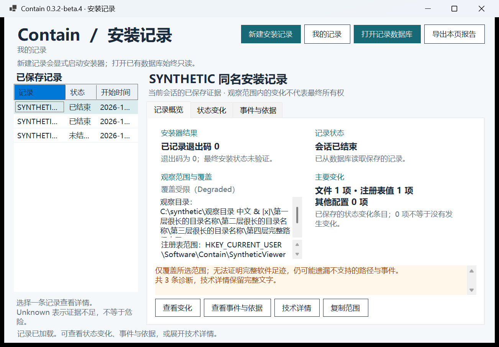

# Beta 4 immutable delivery identity

[Release](https://github.com/LuckyLivio/Contain/releases/tag/v0.3.2-beta.4) ·
[Windows x64 ZIP](https://github.com/LuckyLivio/Contain/releases/download/v0.3.2-beta.4/contain-0.3.2-beta.4-windows-x64.zip) ·
[SHA-256](https://github.com/LuckyLivio/Contain/releases/download/v0.3.2-beta.4/SHA256SUMS.txt).

Frozen source: `681aad7cfb938d6d6204b2c1cc9cbd7431f73674`.
The ZIP is the unmodified accepted [Windows CI artifact](https://github.com/LuckyLivio/Contain/actions/runs/42063050676).
All 476 members, 475 manifested files and 390 exact tracked source files were
verified. The normal PR #7 merge adds delivery documentation after this runtime
source, without rebuilding or repacking the accepted package.

CI passed 50 quality gates and 52 native desktop checks at actual DPI 96. The
same-source local candidate passed all 52 at actual DPI 144; the exact downloaded
CI artifact passed ten focused overview checks there. Zero new installation
captures were requested. Data is explicitly synthetic and isolated; real personal
libraries were excluded. Original failed candidates and private evidence remain
local, and the original Program Files incident remains unconfirmed in Issue #5.

[Nonzero exit](overview-nonzero.png) · [Unfinished record](overview-unfinished.png) ·
[Full behavior, results and limits](../../record-overview-beta4.md) ·
[Build identity](BUILD-IDENTITY.json).
