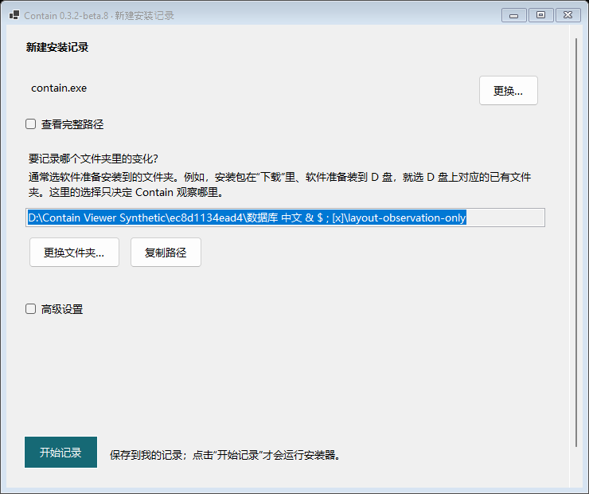

# Follow-installer research candidate

Status: **controlled capability experiment passed**. Product-page and packaged-EXE
acceptance are recorded separately in the [Beta 9 delivery](follow-installer-beta9.md)
and its immutable release build identity.

## Existing behavior and failure boundary

At baseline `a1f9876f4976c2e35b443d9634bbb06fa19f1927`, omitting CLI `--watch`
chooses the installer's parent directory (`capture.rs`, `install_inner`). Baseline
snapshots and directory notifications cover that directory. In the ETW decoder,
`begin_file_name` caches only names inside those roots; `file` discards remaining
out-of-scope paths before event construction, request tracking and persistence.
Removing only the desktop's folder requirement cannot recover those events.

The experimental `--follow-installer` option is explicit and mutually exclusive
with directory, registry and snapshot selection. Its target is source file
operations by the launched process instance and verified direct children. It must
not infer identity from the header PID, timing or path. Dynamic names remain
historical observations. There is no installation-before file baseline, no
Added/Modified inference from a later read, and no final ownership conclusion.

## Controlled question

The independent fixture chooses two destinations outside its package directory.
The launched root writes a file in A; a direct child creates B at runtime and
writes another file. An independently started process writes a third file in A.
None of those paths is supplied as a product observation root. Fixture truth
records successful writes, PID, creation time and syscall intervals independently
of the product search/attribution implementation.

The frozen candidate must retain actual source IDs for the two target writes,
explain their exact process instances, preserve strict completion/loss rules, and
read the same saved session and explanations in fresh read-only CLI processes.
The unrelated write cannot become installer-family evidence. If that third
resource is excluded by the actor filter, the result must report no retained ID
rather than claiming no system write occurred. Limits, refused evidence and
unresolved operations must remain visible in the aggregate result.

Candidate admission is bounded to 2,048 records / 8 MiB, 256 KiB per record and
4,096 discovered resources; existing request correlation remains bounded to
16,384 entries. Raw evidence is capped at 64 MiB and descendant quiet drain at
10 seconds. The experiment imposes a separate 120-second collector deadline and
30-second read-only query deadlines. These are refusal/diagnostic boundaries,
not a claim that every finalization path has a new interrupt mechanism. Candidate
losses remain context losses and suppress promotion. The mode is persisted as
optional `backend.follow_installer` metadata through the existing storage JSON;
old manual records retain their existing representation.

## Desktop baseline and design

[Provenance and SHA-256](examples/follow-installer-before.json): actual Windows
production controls, 740 x 620, Windows 10.0.26100.0, actual 96 DPI, isolated
synthetic configuration. The retained capture's Git tree is identical to this
task's baseline. It is not a mockup. Matching simulated-scale captures remain
separate from real DPI evidence.

After capability acceptance, the proposed WinForms page groups the installer
filename, expandable/copyable path, mode and primary action together. Explicit
manual-folder observation remains available for before/after comparison. Advanced
settings and raw diagnostics stay collapsed. This avoids a framework migration.

Read-only design references: [Fluent 2 typography](https://fluent2.microsoft.design/typography),
[layout](https://fluent2.microsoft.design/layout), and
[button usage](https://fluent2.microsoft.design/components/web/react/core/button/usage),
accessed 2026-11-06. No code, icons, fonts or new runtime dependencies were adopted.
The implementation and its validation are Contain's work. Existing WinForms and
the pinned vendored ferrisetw retain their existing licenses and notices; this
experiment does not replace them with PerfView/TraceEvent.

## Frozen capability result

[Windows experiment 42183825533](https://github.com/LuckyLivio/Contain/actions/runs/42183825533),
source `749447e3f896fe779a297cc12737b6e99bc21940`, passed all 24 checks in one
capture with no retries. [Reviewed aggregate](examples/follow-installer-experiment-42183825533.json).
Saved session: `1a51a489-dab1-4ce7-80fe-77d36af2601e`.

| Answer | Actual event | Process-instance proof | Result |
| --- | --- | --- | --- |
| Root write in A | `35da64dd-eba3-42c7-a060-1194cb98e5af` | PID 6264, creation FILETIME `134384253033844729` | `write_requested`, High, InstallerPid, completion true |
| Direct child write in newly created B | `4de44c60-230b-4490-98f0-c1cd0f22d70c` | PID 5736, creation FILETIME `134384253033930286`; exact parent instance checked | `write_requested`, High, DescendantProcess, completion true |
| Independent writer in A | No retained event ID | Independent syscall truth and content check passed | Excluded/unobserved in this session; no claim that no system operation occurred |

Both selected events were reread with identical explanations in fresh CLI
processes. Both have `state_validated=false`, `current_path_verified=false`, and a
historical `file_object_cache` name. Each target also retained a separate
MissingWriter/Unknown write; those were not promoted. There is no before baseline
or final ownership claim.

Admission accounted for 2,535 candidates: 176 admitted, 2,250 excluded and 109
unresolved, with zero candidate drops. High water was 86 records / 100,827 bytes.
The raw journal persisted 274 records / 294,239 bytes under the 64 MiB limit, with
no persistence/quota loss. The self-I/O counter was zero; absence of retained
private I/O passed, but zero does not prove such I/O never occurred.

The separate quality run 42183825660 passed 53 gates, 366 nextest cases (7 skipped),
including all six new Windows-only tests. Workspace line/function coverage was
75.8090%/76.9184%; original-package coverage 72.8887%/75.4015%. These include inline
tests. Unit coverage is not the source of the live ETW acceptance claim.
