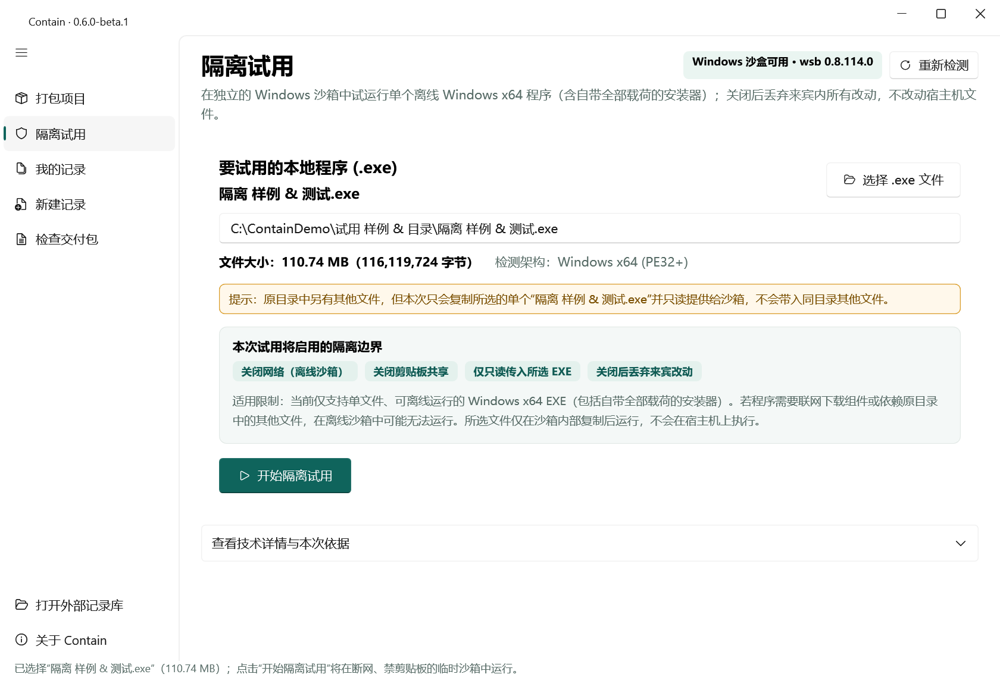
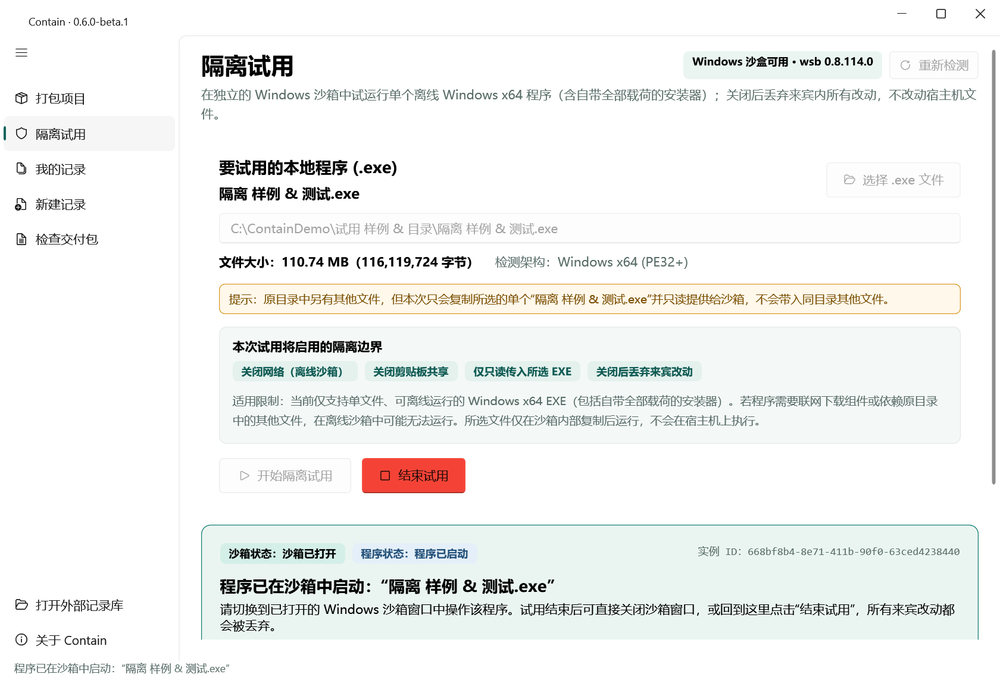
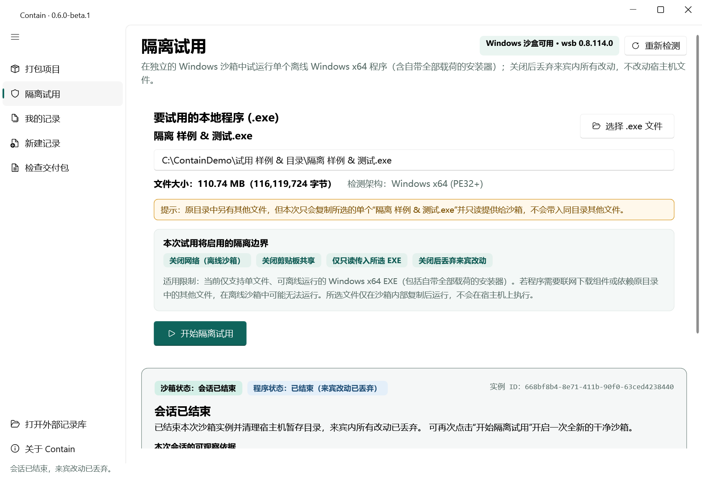

# Contain v0.6.0-beta.1 候选版「隔离试用」验收记录

> 状态：**候选试运行（Draft PR，未发布 GitHub Release）**。公开发布的最新稳定版仍为 `v0.5.0`。

## 1. 功能边界与隔离策略

- **入口与兼容性**：保留「打包项目」作为首次启动默认页，在左侧导航栏并列新增「隔离试用」。
- **支持范围**：单个、可离线运行的 Windows x64 `.exe`（包含自带全部载荷的安装器）。若程序依赖联网下载或同目录其他文件，页面明确提示该限制。
- **隔离边界**（每次启动均写入独立配置的 Windows Sandbox）：
  - `Networking = Disable`（关闭网络）
  - `ClipboardRedirection = Disable`（关闭剪贴板共享）
  - 每次会话创建独立临时暂存目录，仅复制所选单个 `.exe`，并以 `ReadOnly = true` 映射至来宾 `C:\ContainTrialInput`；引导脚本与 UTF-8 JSON 元数据（`target.json`）通过独立只读目录映射至 `C:\ContainTrialBootstrap`，不向受测程序暴露任何可写宿主机目录。
  - 来宾内仅把目标程序复制到来宾本地可写目录 `C:\ContainTrialRun` 后启动；文件名严格以 UTF-8 JSON 数据传递，不拼接进命令行，安全支持中文、空格与 `&`。
  - 每次会话严格跟踪 `wsb start --raw` 返回的精确实例 UUID；轮询、窗口关闭检测与停止仅作用于该精确实例 ID 及对应暂存目录，不扫描或影响宿主机上的其他沙箱实例。
  - 明确区分 **「沙箱已打开」**（`wsb start` 返回实例 ID、`wsb connect` 启动且该实例响应只读 `ExistingLogin` 就绪探测）与 **「程序已启动」**（来宾启动器确认进程创建并返回运行结果）。
  - 本轮不包含配置回退、安全评分或完整 ETW 行为采集。

## 2. 候选构建身份

- **候选版本**：`0.6.0-beta.1`（核心采集组件保持独立版本 `0.3.2-beta.10`）
- **代码构建提交**：`eb99eba87d36f981f75b09b31bf8a409046dc39d`
- **解压即用候选 ZIP**：`contain-0.6.0-beta.1-windows-x64.zip`
- **ZIP SHA-256**：`22fb111a08eb641bde173c50e7ec7e28a5f75271a7bea395099b33f719a154e2`
- **入口 `Contain.Viewer.exe` SHA-256**：见随包 `identity.json` / `package-spec.json`

## 3. 真实 Windows 11 x64 实机验收（非模拟）

以下全部项目均在启用了 Windows Sandbox（`wsb.exe 0.8.114.0`）的原生 Windows 11 x64 宿主机上，直接运行从 `contain-0.6.0-beta.1-windows-x64.zip` 解压出的 `Contain.Viewer.exe` 完成。示例测试程序为独立编写、源码可审计的无害单文件自包含 WinForms `.exe`（放置在含中文、空格与 `&` 的目录，并同目录放置未选中的旁侧文件 `同目录未选文件.txt`）。

| 验收项 | 观察方法 | 实际结果 |
| --- | --- | --- |
| 首次启动默认入口 | 使用全新空 `LOCALAPPDATA` 启动 `Contain.Viewer.exe` | 通过：窗口标题 `Contain · 0.6.0-beta.1`，默认进入「打包项目」 |
| 沙盒能力前置检测 | 切换至「隔离试用」 | 通过：自动识别 `Windows 沙盒可用 · wsb 0.8.114.0` |
| 特殊字符路径 + 旁侧文件提示 | 选中 `试用 样例 & 目录\隔离 样例 & 测试.exe`（110.74 MB，PE32+ x64） | 通过：正确显示文件名、大小、架构、旁侧文件不带入提示、隔离规则与范围限制 |
| 快速重复点击防并发 | 连续快速触发 3 次「开始隔离试用」 | 通过：后 2 次被同步拦截，`wsb list --raw` 仅存在 1 个实例（`defc7ea5-3842-4a78-8423-9a2acbc28237`） |
| 「沙箱已打开」与「程序已启动」区分 | 检查界面徽章与 `WindowsSandboxRemoteSession.exe` 命令行 | 通过：可见「沙箱状态：沙箱已打开」与「程序状态：程序已启动」；远端会话进程命令行精确携带 `--id defc7ea5-...` |
| 只读输入与旁侧文件隔离 | 来宾示例程序检查 `C:\ContainTrialInput` 文件列表并尝试写入探测文件，宿主机通过 `wsb exec -r ExistingLogin --raw` 核验返回码 | 通过（退出码 `101`）：输入目录仅见所选单个 EXE、未见旁侧 `.txt`、写入只读输入目录被拒绝 |
| 网络隔离 | 来宾示例程序枚举非回环 `Up` 网卡数量，宿主机通过 `wsb exec --raw` 核验 | 通过（退出码 `102`）：`non_loopback_up_count == 0` |
| 剪贴板隔离 | 宿主机剪贴板预先写入无害测试文本（40 字符），来宾示例程序在 STA 线程读取剪贴板，宿主机通过 `wsb exec --raw` 核验 | 通过（退出码 `103`）：来宾读取长度为 0，未包含宿主机测试文本 |
| 会话 1 来宾本地标记写入 | 来宾示例程序检查并写入 `C:\ContainTrialMarker\session-marker.txt` | 通过（退出码 `100` / `104`）：启动前标记不存在，成功在来宾本地写入唯一标记 |
| 会话 1 直接关闭沙箱窗口 | 向该实例对应的 `WindowsSandboxRemoteSession.exe` 窗口发送 `WM_CLOSE`，不操作 Contain | 通过：约 1 秒内 Contain 自动识别并显示「会话已结束（沙箱窗口已关闭）」，`wsb list --raw` 归零，暂存目录归零 |
| 无关沙箱并发冲突与互不干扰 | 宿主机先独立启动另一无关沙箱（`1aaeb310-...`），再在 Contain 点击「开始隔离试用」 | 通过：Windows 沙盒返回 `0x800401F6 (CO_E_APPSINGLEUSE)`；Contain 给出明确中文说明（本机已有其他沙箱在运行、Contain 不会代为关闭），回滚自身暂存目录，且无关沙箱 `1aaeb310-...` 保持运行未受影响 |
| 会话 2 恢复 + 旧标记消失 + 从 Contain 结束 | 自行关闭上述无关沙箱后，在 Contain 再次点击「开始隔离试用」启动新实例（`9ad38008-...`），核验标记后再点击 Contain 内「结束试用」 | 通过（退出码 `100`）：**会话 1 的 `C:\ContainTrialMarker\session-marker.txt` 在会话 2 启动前已完全消失（`marker_existed_before == false`）**；点击「结束试用」后显示「会话已结束」，实例停止且暂存目录归零 |
| 启动失败与恢复路径 | 选中临时副本后删除原文件再点击「开始隔离试用」 | 通过：显示明确失败原因与下一步指引，暂存目录自动回滚清理；重新选择有效程序后「开始隔离试用」恢复可用 |
| 宿主机原文件完整性 | 对比测试前后 `隔离 样例 & 测试.exe` 的 SHA-256 | 通过：前后完全一致（`2aaf5d94d9520cb19875d2d9e96187bac6513e196945c83a812605886511f6b7`） |
| 定向回归（「打包项目」「我的记录」与示例库） | 切换导航页、正常关闭主窗口（退出码 0），并用同包 `contain.exe --read-only` 解释 `samples\viewer-demo.db` 中 `synthetic-finished-event-0` | 通过：导航、退出及示例库事件依据读取均无回归 |

### 桌面实机界面截图

- **「隔离试用」入口页（已检测到 `wsb 0.8.114.0` 并选中含中文/空格/`&` 路径程序，展示旁侧文件提示与隔离边界）**

- **运行中会话（区分显示「沙箱状态：沙箱已打开」「程序状态：程序已启动」与实例 ID，并提供「结束试用」）**

- **会话已结束状态（实例停止、暂存目录清理、可再次开启新沙箱）**

> 截图环境说明：自动化实机验收运行在宿主机隔离的后台 Win32 桌面会话中；Windows DWM 仅对当前前台交互桌面合成 `WindowsSandboxRemoteSession` 的 DXGI RDP 客户区画面，因此在后台会话中对沙箱窗口执行 `PrintWindow` 仅能捕获其真实外框（`Windows Sandbox` 标题栏，`3072×1728`），无法从宿主机侧直接截取 RDP 客户区画面。来宾内示例 GUI 程序的启动、运行路径、只读/旁侧文件隔离、断网、剪贴板隔离与会话间丢弃均已通过 `wsb exec --id <id> -r ExistingLogin --raw` 在真实运行的沙箱内逐项实测核验。在普通用户前台桌面点击「开始隔离试用」时，Windows Sandbox 交互窗口将直接正常显示。

## 4. 确定性模型与打包自动化测试（合成/模拟）

以下项目由确定性单元测试与脚本验证（不依赖真实 Windows Sandbox 或真实 ETW）：

- `Contain.Desktop.Model.Tests`：**71/71 通过**（其中新增 8 项 `isolated_trial` 覆盖：PE 架构校验与非 PE/ARM64 拒绝、XML 特殊字符转义与全只读挂载、`wsb --raw` JSON 解析与 `0x800401F6` 冲突检测、精确实例 ID 命令行匹配、能力受阻提示、沙箱打开与程序启动分离、快速连点防重入、来宾启动失败不误报已启动、外部关窗自动停止与清理、启动失败回滚与重试恢复）。
- `scripts/test-package-source-desktop.py`：**10/10 通过**。
- `scripts/check-fuzz-lock.py`：**通过**。
- `cargo test --workspace --locked` 与 `cargo deny --locked check`：**全部通过**。
- `dotnet list ... --vulnerable --include-transitive`：**无已知漏洞依赖**。

## 5. 尚未实测的场景

1. **未启用 Windows Sandbox / Windows 家庭版 / 组策略禁用环境**：该分支的前置检测状态机与文案已通过合成模型测试覆盖，本轮未在未启用 Windows Sandbox 的物理机上实测。
2. **需要联网下载的在线安装器或依赖同目录 DLL/数据文件的多文件绿色软件**：属于本轮明确声明不支持的边界，界面已写明限制，未对具体第三方在线安装器逐一适配。
3. **ARM64 Windows 设备或 32 位 x86 遗留程序实机运行**：PE 校验已拦截 ARM64 并标注 x86 提示，本轮实机测试仅覆盖原生 Windows 11 x64 与 x64 单文件程序。
4. **宿主机前台交互桌面下用户肉眼目视操作 Windows Sandbox 窗口**：本轮自动化在宿主机隔离后台桌面完成交互闭环与来宾实测，前台桌面下的视觉体验与交互手感待用户使用候选 ZIP 直接试用确认。
