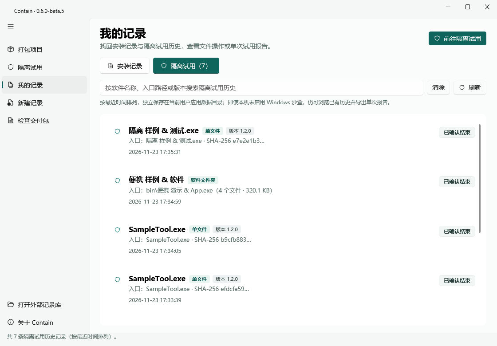
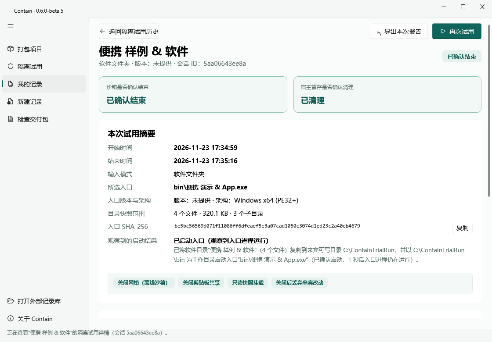

# Contain v0.6.0-beta.5 候选版「隔离试用」验收记录

> 状态：**候选试运行（Draft PR #31，未发布 GitHub Release）**。公开稳定版继续为 `v0.5.0`。

## 1. v0.6.0-beta.5 核心改进（隔离试用历史、单次报告和再次试用）

1. **「我的记录」新增「隔离试用」独立分类，关掉 Contain 后可随时找回**：
   - 在「我的记录」顶部增加「安装记录」与「隔离试用」分类切换；原有个人安装记录库（`contain.db`）和外部只读 SQLite 记录库 100% 保持原样独立可用。
   - 「隔离试用」历史按最近开始时间倒序排列，显示软件名、版本（可得时）、输入类型（`单文件` / `软件文件夹`）、入口摘要与最终结果，支持按软件名称、入口相对路径或版本即时搜索。
   - 试用结果页新增 **「查看本次记录」** 按钮，可直接跳转到对应单次试用详情。
   - 隔离试用历史完全不依赖 Windows Sandbox 可用性：未启用沙盒或家庭版电脑仍可浏览已有历史并导出版本化 JSON 报告。
   - 会话粒度清晰：每次点击「开始隔离试用」进入流程生成独立会话记录（同一程序试两次产生两条）；同一次试用历经窗口关闭、异常退出恢复、重新检查、重试结束或重试清理始终更新同一条记录；仅浏览文件、扫描目录或计算 SHA-256 绝不产生试用历史。
2. **单次试用详情与版本化 JSON 报告共用单一数据源**：
   - 详情页与「导出本次报告」共同读取 `TrialSessionReport`（`schema_version = 1`，`protocol = "contain-isolated-trial-report-1"`），涵盖开始/结束时间、单文件或文件夹模式、所选入口、架构/版本、观察到的启动结果与完整时间线；文件夹模式另展示快照文件数、子目录数、总大小与入口相对路径。
   - **入口 SHA-256 严格对应本次实际暂存运行的字节**：在暂存快照流式复制入口文件时单趟计算并固化记录，绝不在事后重读宿主机路径；未取得可靠哈希时如实展示 `未记录`。
   - **双事实分离展示**：「沙箱是否确认结束」与「宿主暂存是否确认清理」独立卡片呈现；查询超时等场景如实记录 `状态未知` / `尚未确认`，后续取得可靠证据后再更新同一条记录。
   - **默认导出隐私边界**：版本化 JSON 报告默认包含显示名称、相对入口、入口 SHA-256、目录范围与事件摘要，**不自动写入宿主机绝对路径、Windows 用户名或原始诊断命令**；明确声明证据边界，仅以 Contain 在宿主机与启动阶段实际观察到的依据为限，时间线中的“已启动入口”仅表示当时观察到入口进程启动，不新增来宾向宿主机可写共享。
3. **从详情页「再次试用」（进入确认页，不自动启动沙箱）**：
   - 本地历史中仅作为回放提示保存的路径（`local_hints`）不随报告导出。
   - 点击「再次试用」按原输入模式与入口回到「隔离试用」确认页，绝不自动启动沙箱：
     - 原文件或目录已移动/删除时明确提示并允许重新选择；
     - 历史记录含入口 SHA-256 且当前磁盘文件哈希变化时，明确警示 **「文件已变化」** 并展示历史/当前摘要；
     - 文件夹模式重新扫描当前目录并核对原相对入口及入口哈希；
     - 用户确认后点击「开始隔离试用」生成全新会话记录，原历史记录保持逐字节不变。
4. **独立存储与容错**：
   - 试用历史独立保存在当前用户应用数据目录的 `IsolatedTrial\History\<session_id>.json`（完整支持 `CONTAIN_VIEWER_TEST_ROOT` 隔离），与 `%TEMP%\Contain-IsolatedTrial` 暂存目录及 `contain.db` 完全分离。
   - 若历史写入失败（如磁盘满/权限异常），界面明确警告「记录保存失败」，且**绝不阻塞用户停止本次沙箱或清理暂存目录**。

## 2. 候选构建身份

- **候选版本**：`0.6.0-beta.5`（核心采集模块保持 `0.3.2-beta.10`）
- **候选包构建提交 SHA**：`12a6246a9d0de2cb4e3013f974a2fdf0772f6cb8`
- **便携解压即用 ZIP**：`contain-0.6.0-beta.5-windows-x64.zip`（71,359,193 字节）
  - SHA-256：`0494f42b19bed243da0bbab262a66b7ff621c4f03f204d6cf48d631c11a1355a`
- **桌面安装包 Setup**：`Contain-Setup-0.6.0-beta.5-x64.exe`（51,455,274 字节，Inno Setup 6.7.3，`AppId={8F4E2D91-5C3A-4B7E-9A16-2D8C4E7F1035}`，当前用户最低权限安装，未签名候选包）
  - SHA-256：`b793086560ed2922ffb03cc974837a6e50e0b103c12e1a9dc43921a6cfbf8a56`

## 3. 真实 Windows 11 x64 验收（解压最终 Beta.5 候选 ZIP 实测）

测试全程通过 `CONTAIN_VIEWER_TEST_ROOT` 隔离在独立目录，并预置合成个人 `contain.db` 样本以验证旧安装记录库兼容，未触碰宿主机真实个人记录库。

| 验收场景 | 实际结果 |
| --- | --- |
| 1. 同一单 EXE 试两次 → 重启 Contain → 从旧记录「再次试用」 | 通过：同一单 EXE（`隔离 样例 & 测试.exe`）两次完整沙箱运行后重启 Contain，「我的记录 → 隔离试用」按最新时间排列显示 2 条独立记录（`efbd75dddec3`、`1543e9b52d24`，均记录精确 SHA-256 `e7e2e1b3…`）；打开较早记录点「再次试用」进入确认页且**未自动启动沙箱**，提示哈希一致；确认启动并结束后生成第 3 条记录（`aedb9a65961a`），原较早历史 JSON 文件与回放前**逐字节一致** |
| 2. 两个同名但内容不同的 EXE + 替换源文件校验 | 通过：`SampleTool.exe` 两个不同内容版本分别运行生成 `d89b58cdea68`（SHA-256 `efdcfa59…`）与 `827226f52419`（SHA-256 `b9cfb883…`），在列表与详情中可清晰区分；将源文件 A 替换为新内容（`82b059aa…`）后，历史记录 A 详情仍保留原始 `efdcfa59…`；点击「再次试用」未自动启动并明确警示 **「文件已变化」** |
| 3. Beta.4 多文件便携样例完整试运行 +「查看本次记录」+ 真实导出 JSON | 通过：使用 `便携 样例 & 软件`（`4 个文件 · 320.1 KB · 3 个子目录`，入口 `bin\便携 演示 & App.exe`）在真实沙箱运行并结束后，点击结果页「查看本次记录」直达详情（会话 `5aa06643ee8a`），核对目录范围、相对入口、入口 SHA-256（`be5bc565…`）、观察到的启动结果与双状态卡片（`已确认结束` / `已清理`）；通过界面「导出本次报告」与原生保存对话框导出版本化 JSON（见下方示例文件），校验 `schema_version = 1`、`protocol = "contain-isolated-trial-report-1"`，且**零宿主机绝对路径、零用户名、零原始诊断命令** |
| 4. 复用 Beta.3 真实前端异常退出恢复 + 旧个人 `contain.db` 兼容 | 通过：启动真实沙箱实例 `ca57cde4-01e9-40d2-a2a0-6a09b2fb88af`（会话 `f80fd52d8c1e`，当时历史总数 `7`）后仅强杀 `Contain.Viewer.exe`；重新打开 Contain 弹出恢复横幅与「上次试用仍在运行」，点击「结束这次试用」后确认「试用已结束」「本次临时文件已清理」；核查历史记录总数仍严格为 **`7`（该会话仅 1 条记录）**，保留原入口 SHA-256，时间线合并崩溃前事件与「启动恢复检查」「试用已结束」，最终状态 `ConfirmedEnded` / `Cleaned`，`wsb list` 与暂存目录归零；切回「我的记录 → 安装记录」确认预置个人 `contain.db` 正常读取 3 条安装记录 |

## 4. 两张核心界面实拍截图与真实导出报告示例

1. **「我的记录 → 隔离试用」历史列表（真机运行 Beta.5 生成的 7 条持久化记录：按最近时间排列，清晰展示单文件与便携文件夹徽标、入口摘要、同名不同内容 EXE 的不同 SHA-256 前缀与结果状态）**

2. **单次隔离试用详情页（便携文件夹会话 `5aa06643ee8a`：独立呈现「沙箱是否确认结束」与「宿主暂存是否确认清理」双卡片、目录快照范围、相对入口、本次实际传入的入口 SHA-256、观察到的启动结果，以及右上角「导出本次报告」「再次试用」）**

3. **Beta.5 候选版实际导出的版本化 JSON 报告示例**：
   - 文件：[docs/v0.6.0-beta.5/sample-portable-trial-report.json](v0.6.0-beta.5/sample-portable-trial-report.json)
   - SHA-256：`13a085bf48c1875e7b8830c15b59371dc4c2c45b9144f1fa429359569c6b3820`

## 5. 确定性模型与自动化测试（合成 / 模拟）

- `Contain.Desktop.Model.Tests`：**88/88 通过**（在 Beta.4 的 82 项基础上新增 6 项 Beta.5 专项测试）：
  1. 仅浏览文件/计算 SHA-256 产生 0 条历史（且空库只读刷新不创建目录）；同一 EXE 试两次产生两条独立记录，重启后按最新时间排列并支持按软件名/入口搜索；
  2. 单次会话历经结束查询超时（`Unknown` / `Remaining`，无伪造结束时间、`未记录` 哈希回退）→「重新检查」→「重试清理」全过程严格保持 1 条记录并分字段更新双状态；
  3. 前端崩溃恢复按 `session_id` 承接既有记录，保留原开始时间、目录范围、入口 SHA-256 与崩溃前时间线，恢复结束后仍严格保持 1 条记录；
  4. 真实 `StageInputSnapshotAsync` 单趟流式计算入口 SHA-256、同名不同内容 EXE 哈希区分、替换源文件不改写旧记录且「再次试用」警示「文件已变化」、删除源文件提示重选、目录模式重新扫描检测目录与入口哈希变化；
  5. 历史写入抛 `IOException` 时展示可见警告，且 `EndTrialAsync()` 仍完整停止沙箱并清理暂存目录；
  6. 模拟无 Windows Sandbox 的家庭版机器仍可浏览 `TrialHistoryViewModel` 并导出 `schema_version = 1` JSON 报告，且导出内容不含宿主机路径、当前用户名、本地回放提示或原始 CLI 命令。
- `cargo test -p contain-workflow --locked`（55/55）、`scripts/test-package-source-desktop.py`（10/10）、`scripts/check-fuzz-lock.py`、`cargo deny --locked check` 与全库卫生扫描全部通过。

## 6. 延续的 Beta.2 / Beta.3 / Beta.4 验收基础

`v0.6.0-beta.2` 至 `v0.6.0-beta.4` 已验证的离线 `v0.5.0 → v0.6.0` 原位升级与个人记录库保留、无沙盒环境只读查看与 8 类非提权能力分类、结束状态双事实分离确认机制，以及便携多文件目录隔离运行（含 `7-Zip` 目录与重解析点拦截）均在 `v0.6.0-beta.5` 完整保留（历史截图留存于 `docs/v0.6.0-beta.2/`、`docs/v0.6.0-beta.3/` 与 `docs/v0.6.0-beta.4/`）。
