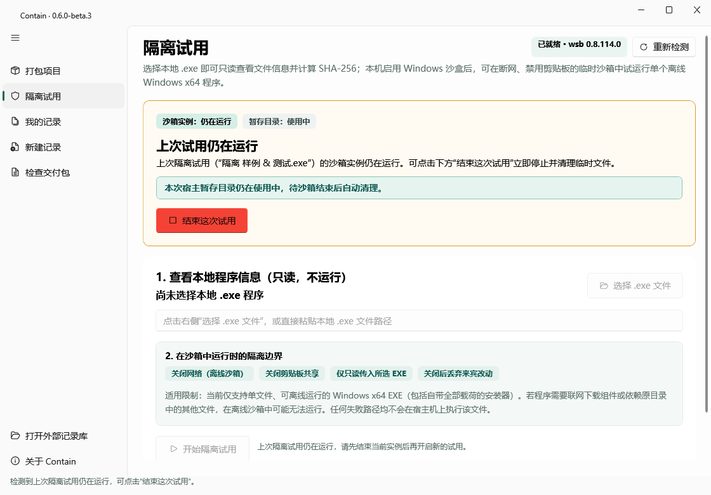

# Contain v0.6.0-beta.3 候选版「隔离试用」验收记录

> 状态：**候选试运行（Draft PR #31，未发布 GitHub Release）**。公开稳定版继续为 `v0.5.0`。

## 1. v0.6.0-beta.3 核心改进（会话确认与恢复）

1. **修正结束状态误报，将“沙箱实例状态”与“宿主暂存目录状态”分开记录**：
   - 将 `SandboxInstanceState`（`NotCreated` / `Running` / `ConfirmedEnded` / `Unknown`）与 `TrialStagingState`（`NotCreated` / `Active` / `Cleaned` / `Remaining` / `Unconfirmed`）作为两个独立事实贯通服务层、状态机、主标题、徽标、摘要与折叠技术详情。
   - **仅在取得可靠结束证据时显示「试用已结束」**：即 `wsb stop` 明确成功，或随后新鲜执行且成功解析的 `wsb list --raw` JSON 中确认不含目标实例 ID。`wsb.exe` 暂时不可用、命令超时、非零退出码或输出不可解析均保持 `Unknown`（显示「暂时无法确认试用是否已结束」与「重新检查」「重试结束」），不再把空列表或解析失败误判为「试用已结束」。
   - 启动失败回滚不再硬编码“已清理”，而是读取真实回滚结果；若回滚期间无法确认实例已停止，则转入 `Unconfirmed` 并保留关联信息供后续重试。
2. **异常退出后的启动恢复与安全护栏**：
   - 在 `wsb start --raw` 返回真实实例 UUID 后立即原子写入最小待恢复记录（位于当前用户应用数据目录 `%LOCALAPPDATA%\Contain\IsolatedTrial\pending-session.json`，并严格遵循 `CONTAIN_VIEWER_TEST_ROOT` 测试隔离边界）。
   - 下次打开 Contain 时在后台执行有界超时的启动恢复检查，不阻塞主窗口或「打包项目」「我的记录」「检查交付包」等页面；在非「隔离试用」页展示可一键跳转的非阻塞横幅。
   - 依实测状态给出明确操作：实例仍在运行 → 提示「上次试用仍在运行」并提供「结束这次试用」；状态无法确认 → 提示「暂时无法确认上次试用状态」并提供「重新检查」与「结束这次试用」（保留记录）；实例已确认结束但暂存目录仍有残留 → 提供「重试清理」。**仅在实例确认结束且暂存目录确认清理后才移除待恢复记录**。
   - 护栏：仅按记录中的精确 UUID 停止目标实例；暂存目录清理前严格校验其为 Contain 暂存根目录下的直接子目录且不含路径穿越或重解析点；记录损坏或路径被篡改时安全隔离忽略且不删除外部目录；通过 `owner_pid` 与进程启动时间戳避免双开 Contain 窗口时互相误关正在运行的沙箱。

## 2. 候选构建身份

- **候选版本**：`0.6.0-beta.3`（核心采集模块保持 `0.3.2-beta.10`）
- **候选包构建提交 SHA**：`e2f68e0eced6fdeecbf04dffa3cd08b2458d8e71`
- **便携解压即用 ZIP**：`contain-0.6.0-beta.3-windows-x64.zip`（71,292,156 字节）
  - SHA-256：`c0251e7f893249d808ea5d5c3c1a1a28bf22479ee776455d670249603f895dab`
- **桌面安装包 Setup**：`Contain-Setup-0.6.0-beta.3-x64.exe`（51,406,054 字节，Inno Setup 6.7.3，`AppId={8F4E2D91-5C3A-4B7E-9A16-2D8C4E7F1035}`，当前用户最低权限安装，未签名候选包）
  - SHA-256：`aed23676730ffffd2ff5d2be9cbaab8cfbd5f2c6c08b9bd6425b8e128c5ed38a`

## 3. 真实 Windows 11 x64 定向高信号验收（非模拟）

### 3.1 真实宿主机异常退出恢复与正常流程验收（完整解压候选 ZIP 后运行 `Contain.Viewer.exe`）

测试全程通过 `CONTAIN_VIEWER_TEST_ROOT` 隔离在独立测试目录，未触碰宿主机真实个人记录库。

| 验收项 | 实际结果 |
| --- | --- |
| 启动候选版并创建真实沙箱会话 | 通过：`Contain · 0.6.0-beta.3`，能力 `已就绪 · wsb 0.8.114.0`；选中 `隔离 样例 & 测试.exe` 启动实例 `a089770d-abbf-4ad6-9862-1a369f0c8a71`，立即在隔离应用数据目录写入 `pending-session.json`（`owner_pid` 精确匹配前端进程） |
| 仅强杀前端 `Contain.Viewer.exe` 后复核沙箱存活 | 如实观察：**沙箱保持存活**（`sandbox_survived_crash = true`）：仅终止 `Contain.Viewer.exe`（`entireProcessTree = false`）后，`wsb list --raw` 仍列有实例 `a089770d-abbf-4ad6-9862-1a369f0c8a71`，且对应暂存目录存在 |
| 重新打开同候选版恢复与清理 | 通过：重启后其他页面（「检查交付包」「打包项目」）立即响应不阻塞；底部自动出现非阻塞提示「检测到上次隔离试用仍在运行，点击前往「隔离试用」结束这次试用。」；进入「隔离试用」后显示主标题「上次试用仍在运行」、徽标「沙箱实例：仍在运行」「暂存目录：使用中」与「已就绪 · wsb 0.8.114.0」；点击「结束这次试用」后确认「试用已结束」「本次临时文件已清理」，`wsb list` 归零、暂存目录与 `pending-session.json` 均已移除 |
| 正常「开始 → 关窗 → 再次试用 → 结束」冒烟 | 通过：会话 1（`9a15b3d4-cfbf-43e5-85f8-aaeb49c7be20`）直接向沙箱窗口发送关闭后自动显示「试用已结束」「本次临时文件已清理」与「再次试用」；点击「再次试用」创建全新会话 2（`bbd7b460-a6bc-4620-8c04-eef52cb678a3`），点击「结束试用」干净结束；主窗口正常退出（退出码 0），`wsb list` 归零，暂存目录残留为 0，原示例文件 SHA-256 不变（`e7e2e1b31073374a8c0486fed8b1adbda892f4058144be912124ae52ce89ea50`） |

### 3.2 干净断网 Windows x64 来宾环境：`v0.5.0 → v0.6.0-beta.3` 原位升级与卸载保库实测

在全新、断网（已校验无活动网卡）的 Windows 11 x64 来宾环境中，使用公开 `v0.5.0` Release 安装包与本轮 `v0.6.0-beta.3` 安装包及合成个人记录库（复制自包内 `samples\viewer-demo.db`，全程未触碰宿主机个人库）完成完整链路实测：

| 阶段 | 实际结果 |
| --- | --- |
| 1. 安装公开 `v0.5.0` Setup | 通过：`Contain-Setup-x64.exe`（SHA-256 `8d7df61f0e5ce42a9e513088feb259394a11de105863669659790922c577a8e0`）静默安装退出码 `0`；安装版本 `0.5.0+ddca87a1926d128821618fc9799aef09d834a6cd`（`contain-workflow 0.5.0`），卸载注册表仅 1 项（`{8F4E2D91-5C3A-4B7E-9A16-2D8C4E7F1035}_is1`） |
| 2. 预置合成个人记录库并读取 | 通过：写入 `%LOCALAPPDATA%\Contain\Records\contain.db`（983,040 字节，SHA-256 `a90edd86286447d80c3e1da676503cc3742035c3411a5b1512faa30d733099af`），`v0.5.0` 下 `contain.exe --read-only list/explain` 正常读出 3 条会话及 `synthetic-finished-event-0` |
| 3. 原位运行 `v0.6.0-beta.3` Setup 升级 | 通过：`Contain-Setup-0.6.0-beta.3-x64.exe`（SHA-256 `aed23676730ffffd2ff5d2be9cbaab8cfbd5f2c6c08b9bd6425b8e128c5ed38a`）静默覆盖安装退出码 `0`；程序更新为 `0.6.0-beta.3+e2f68e0eced6fdeecbf04dffa3cd08b2458d8e71`（`contain-workflow 0.6.0-beta.3`）；**卸载注册表严格保持 1 项**（`DisplayVersion = 0.6.0-beta.3`）；合成个人库 **SHA-256 完全未变**且可读；启动并正常关闭升级后的 `Contain.Viewer.exe`（标题 `Contain · 0.6.0-beta.3`，退出码 `0`）后个人库 SHA-256 仍完全一致 |
| 4. 标准卸载程序与个人库保留 | 通过：运行注册卸载程序 `unins000.exe` 退出码 `0`；`Contain.Viewer.exe`、开始菜单快捷方式与卸载注册表项（剩余 `0` 条）均干净移除；合成个人库 `%LOCALAPPDATA%\Contain\Records\contain.db` **完整保留且 SHA-256 仍为 `a90edd86286447d80c3e1da676503cc3742035c3411a5b1512faa30d733099af`** |

## 4. 恢复界面实际截图（标明真机 / 模拟来源）

- **「上次试用仍在运行」恢复界面（真机运行状态）**：真实 Windows 11 宿主机上先启动真实沙箱实例（`3796460c-8eb4-4bd6-94ac-62a4261416d5`），仅将隔离测试目录的 `pending-session.json` 中 `owner_pid` 置为已退出值以复现前端异常退出后的重启恢复路径，随后启动生产 `MainWindow` 经真实 `wsb list --raw` 确认实例存活并截取当前窗口；截取完成后经 `EndTrialAsync()` 结束该实例并确认 `wsb list` 归零与暂存目录清理完毕。
  - 注：原始截图驱动在完成截图与沙箱/暂存清理后，因调用 `App.InitializeComponent()` 触发 `App.OnStartup` 额外创建了第二个 `MainWindow` 导致退出阶段阻塞，已按精确 PID 终止（驱动退出码 `-1`，未补写为成功退出码）并已为驱动补齐单窗口模式、窗口关闭超时、进程退出看门狗与外层调用超时。

## 5. 确定性模型与自动化测试（合成 / 模拟）

- `Contain.Desktop.Model.Tests`：**77/77 通过**，覆盖 Beta.3 全部 4 项必测状态确认与恢复分支及全部安全护栏：
  1. `wsb stop` 失败，但随后可靠查询确认实例已消失 → 显示「试用已结束」，清理暂存目录并移除待恢复记录；
  2. `wsb stop` 与查询同时失败/超时/输出不可解析 → 绝不显示「试用已结束」，显示「暂时无法确认」与「重新检查」「重试结束」，保留待恢复记录；
  3. 恢复检查时 CLI 暂时不可用随后恢复 → 从 `Unconfirmed` 经「重新检查」转为 `RecoveredRunning`（「上次试用仍在运行」），再经「结束这次试用」干净结束并清除记录；
  4. 实例已确认结束但暂存目录清理失败 → 保留记录并提示「重试清理」，再次重试清理成功后才更新为「试用已结束」并移除记录；
  5. 启动失败真实回滚状态传播、损坏 JSON/越界暂存路径/重解析点拒绝、双开窗口 `owner_pid` 保护、运行监控忽略瞬时 `Unknown` 轮询以及快速重复点击并发保护。
- `cargo test -p contain-workflow --locked`（55 项通过）、`scripts/test-package-source-desktop.py`（10/10）、`scripts/check-fuzz-lock.py`、`cargo deny --locked check` 与全库卫生扫描全部通过。

## 6. 延续的 Beta.2 验收基础

`v0.6.0-beta.2` 已验证并在本轮完整保留：无需 Windows 沙盒即可安装/打开 Contain、8 类非提权沙盒能力精确分类、无沙盒环境只读查看 `.exe` 元信息与异步 SHA-256 计算、ARM64 只读禁跑提示，以及无沙盒干净来宾的离线安装/启动/卸载冒烟（相关参考截图保留在 `docs/v0.6.0-beta.2/`）。
