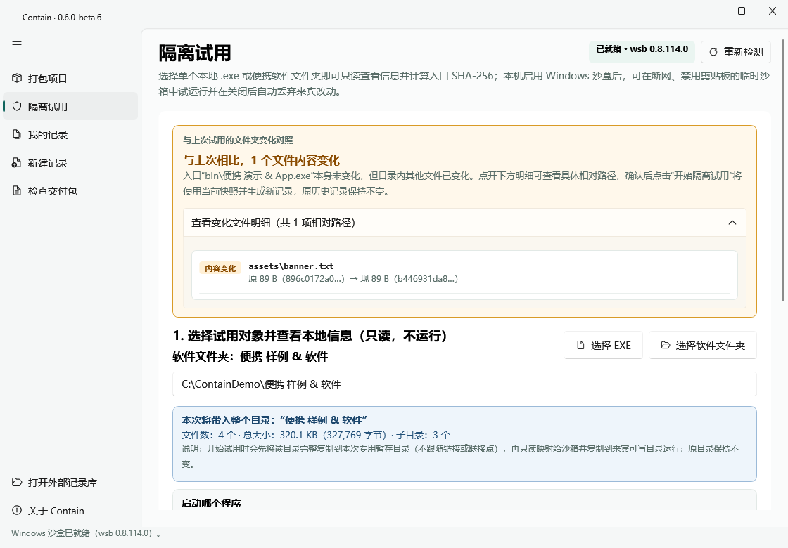

# Contain v0.6.0-beta.6 候选版「隔离试用」验收记录

> 状态：**候选试运行（Draft PR #31，未发布 GitHub Release）**。公开稳定版继续为 `v0.5.0`。

## 1. v0.6.0-beta.6 核心改进（再次试用前的文件夹变化对照）

1. **文件夹快照复制同步逐文件哈希与本地私有清单**：
   - 复用既有单趟流式快照复制流程（`StageInputSnapshotAsync`），复制文件夹内每个文件时同步计算 SHA-256，记录实际带入沙箱的那一份相对路径、字节数与哈希（`local_folder_manifest`），按会话保存在本地用户应用数据目录。
   - **默认导出继续保护目录隐私**：版本化 JSON 报告（`TrialSessionReport`，`schema_version = 1`）不输出 `local_folder_manifest` 与内部目录文件列表，也不写入宿主机绝对路径、用户名或原始诊断命令。
2. **再次试用确认页展示文件夹变化对照与可展开明细**：
   - 从历史记录点击「再次试用」后，在现有「隔离试用」确认页准备对照快照并展示精确汇总，如「与上次相比，1 个文件内容变化」「与上次相比，1 个文件内容变化，2 个新增，1 个移除」。
   - 点开「查看变化文件明细」可逐条查看所有变化/新增/移除文件的相对路径、原/现字节数与 SHA-256 摘要，同名但位于不同子目录的文件（如 `bin\shared.dll` 与 `plugins\shared.dll`）按相对路径分别列出。
   - 仅当历史清单完整且当前目录全部文件核对无误且零差异时，才显示 **「文件内容与上次一致」**。
3. **确认即运行（快照优先复用、变动即刷新再确认）与暂存释放**：
   - 确认页准备好的快照在点击「开始隔离试用」且源目录未变时**直接复用**（零重复复制），保证启动快照与用户所见完全一致。
   - 若打开比较页后、点击启动前源目录再次被修改（包括等字节修改），首次点击「开始隔离试用」会释放旧快照、重新准备新快照、刷新确认页差异并明确提示，**不自动启动沙箱**，等待用户核对后再次确认；再次确认后启动该新快照。
   - 较大目录的对照准备过程实时展示文件数/字节进度、支持「取消准备」且界面保持可操作；取消准备、切换记录/文件或关闭 Contain 窗口时自动释放本次准备的暂存文件。
4. **向后兼容 Beta.5 历史与诚实降级**：
   - 读取真实 Beta.5 旧记录（无整目录清单）时，确认页明确展示 **「上次仅记录了入口文件，可核对入口；完成本次试用后可比较整个文件夹。」**，同时核对入口 SHA-256，旧记录 JSON 文件在磁盘上保持原样不变。
   - 遇到历史清单不完整、读取失败或用户取消对比时，如实说明当前确认到的步骤，绝不误报「文件内容与上次一致」；沿用单 EXE 流程、只读映射、重解析点零容忍与异常退出恢复机制。

## 2. 候选构建身份

- **候选版本**：`0.6.0-beta.6`（核心采集模块保持 `0.3.2-beta.10`）
- **候选包构建提交 SHA**：`abc8afe51923490add994197ebcf4af42f33da2d`
- **便携解压即用 ZIP**：`contain-0.6.0-beta.6-windows-x64.zip`（71,382,768 字节）
  - SHA-256：`dd4203b4473b009921dbc8c10cbec11cb25781711c85e39135aee56b1675b05d`
- **桌面安装包 Setup**：`Contain-Setup-0.6.0-beta.6-x64.exe`（51,475,497 字节，Inno Setup 6.7.3，`AppId={8F4E2D91-5C3A-4B7E-9A16-2D8C4E7F1035}`，当前用户最低权限安装，未签名候选包）
  - SHA-256：`184f3ce35b221673e15c6f76548451637465b12b0c36407a6ff9729009f053bd`

## 3. 真实 Windows 11 x64 验收（解压最终 Beta.6 候选 ZIP + 真实来宾窗口核对）

测试全程通过 `CONTAIN_VIEWER_TEST_ROOT` 隔离在独立目录，使用 Beta.4 既有便携样例副本（`便携 样例 & 软件`，入口 `bin\便携 演示 & App.exe`，4 文件 / `327,769` 字节），并通过 `wsb exec` 直接读取来宾内 `ContainPortableDemoWindow` 实时窗口控件（`IDC_BANNER_LABEL = 1001`）与来宾工作文件文案进行端到端验证。

| 验收场景 | 实际结果 |
| --- | --- |
| 1. 真实 Beta.5 旧记录向后兼容（先由冻结 Beta.5 候选版生成真实历史） | 通过：由冻结 `v0.6.0-beta.5` 生成真实历史 `4a0c73291011`（不含 `local_folder_manifest`）；在 Beta.6 点「再次试用」显示精确文案 **「上次仅记录了入口文件，可核对入口；完成本次试用后可比较整个文件夹。」** 并确认入口 SHA-256 一致；确认启动后在沙箱 `8a28905a-074c-4f9a-9bc9-4613ddf0d52f` 核对来宾窗口展示原文案 `CONTAIN-BETA4-RESOURCE-OK`（退出码 `121`），生成带完整 4 文件本地清单的新基线 `ff8c252fcce0`，原 Beta.5 历史文件**逐字节未变** |
| 2. 原目录完全未变 + 已准备快照优先复用 | 通过：从基线 `ff8c252fcce0` 点「再次试用」，确认页显示 **「文件内容与上次一致」**，准备暂存快照 `d9132b259716`；点击「开始隔离试用」直接**复用同一快照 `d9132b259716`** 启动沙箱 `0ab59ce5-288c-4ead-be4c-5f98145c9808`，来宾窗口核对原文案 `CONTAIN-BETA4-RESOURCE-OK`（退出码 `121`） |
| 3. **核心场景**：仅等长修改 `assets\banner.txt`（入口 EXE、文件数 `4`、总字节 `327,769` 全部相同） | 通过：仅将 `assets\banner.txt`（`89 B`）替换为等长新文案 `CONTAIN-BETA6-BANNER-NEW!`（`89 B`）；从旧记录 `ff8c252fcce0` 点「再次试用」未自动启动，确认页准确提示 **「与上次相比，1 个文件内容变化」**，展开明细仅列出 `assets\banner.txt`（`原 89 B（896c0172a0…）→ 现 89 B（b446931da8…）`）且明确入口未变；确认启动后（会话 `c072c3bf009e`，实例 `de96a769-ca73-46e8-822c-f11a21836d50`），来宾实时窗口控件直接核对显示新文案 **`CONTAIN-BETA6-BANNER-NEW!`**（退出码 `122`） |
| 4. 打开比较页后、点击启动前再次修改源文件 | 通过：从 `c072c3bf009e` 点「再次试用」先显示「文件内容与上次一致」；点击启动前将 `assets\banner.txt` 改为等长 `CONTAIN-BETA6-MIDEDIT-OK!`；首次点「开始隔离试用」**阻止启动**、清理旧准备快照、刷新差异为「与上次相比，1 个文件内容变化」并弹出刷新提示；再次点击确认后启动新快照（会话 `38590e57aa79`，实例 `660cf644-258b-40ec-91df-0056d429e956`），来宾实时窗口核对读到最终确认的 **`CONTAIN-BETA6-MIDEDIT-OK!`**（退出码 `123`）；结束后 `wsb list`、暂存目录残留均归零，默认报告 JSON 仍不含目录清单隐私细节 |
| 5. 窗口关闭释放已准备暂存快照实机复核 | 通过：在 Beta.6 确认页持有 1 个已准备暂存目录时直接关闭主窗口（`WindowPattern.Close()`），进程以退出码 `0` 正常结束，已准备暂存目录由 `1` 归零为 `0` |

## 4. 清晰展示差异的真机界面截图

**等长修改 `assets\banner.txt` 后从旧记录点击「再次试用」的确认页（`Contain · 0.6.0-beta.6`，`wsb 0.8.114.0` 已就绪，保持 `4 个文件 · 320.1 KB · 327,769 字节` 与入口 EXE 不变，准确提示「与上次相比，1 个文件内容变化」并展开相对路径 `assets\banner.txt` 与原/现 `89 B` 哈希对比）：**

## 5. 确定性模型与自动化回归测试（合成 / 模拟）

- `Contain.Desktop.Model.Tests`：**94/94 通过**（在 Beta.5 的 88 项基础上新增 6 项 Beta.6 专项回归）：
  1. 文件夹单趟复制同步逐文件哈希、本地清单保存、默认导出隐私保护、原目录未变时快照零重复复制复用，以及等长非入口文件修改检测；
  2. 新增、移除与**同名但位于不同子目录的文件**（`bin\shared.dll` 未变而 `plugins\shared.dll` 变化，`docs\legacy.txt` 移除，`bin\extra1.dat` 与 `plugins\extra2.dat` 新增）精确产出「与上次相比，1 个文件内容变化，2 个新增，1 个移除」并分别列出相对路径；
  3. Beta.5 旧记录（无 `local_folder_manifest`）展示指定提示且原文件逐字节不改写；清单不完整（`is_complete = false`）绝不误报「文件内容与上次一致」；
  4. 打开比较页后、点击启动前修改源文件，首次点击启动释放旧快照并刷新差异、不启动沙箱、不产生幽灵历史记录，二次确认启动刷新后的快照；
  5. 准备过程取消（「取消准备」期间界面保持可操作）、切换另一条历史记录、以及关闭窗口（`CloseAsync`）均彻底清理已准备暂存目录（残留归零）；
  6. 独占锁定读取失败在对照准备阶段如实报错、清理部分暂存且绝不误报一致。
- `cargo test -p contain-workflow --locked`（55/55）、`scripts/test-package-source-desktop.py`（10/10）、`scripts/check-fuzz-lock.py`、`cargo deny --locked check` 与全库卫生扫描全部通过。

## 6. 延续的 Beta.2 / Beta.3 / Beta.4 / Beta.5 验收基础

`v0.6.0-beta.2` 至 `v0.6.0-beta.5` 已验证的离线 `v0.5.0 → v0.6.0` 原位升级与个人 `contain.db` 保留、无沙盒环境只读查看与历史导出、结束状态双事实分离确认、前端强杀崩溃恢复、同名 EXE 区分及重解析点拦截均在 `v0.6.0-beta.6` 完整保留（历史截图与示例报告留存于 `docs/v0.6.0-beta.2/` 至 `docs/v0.6.0-beta.5/`）。
