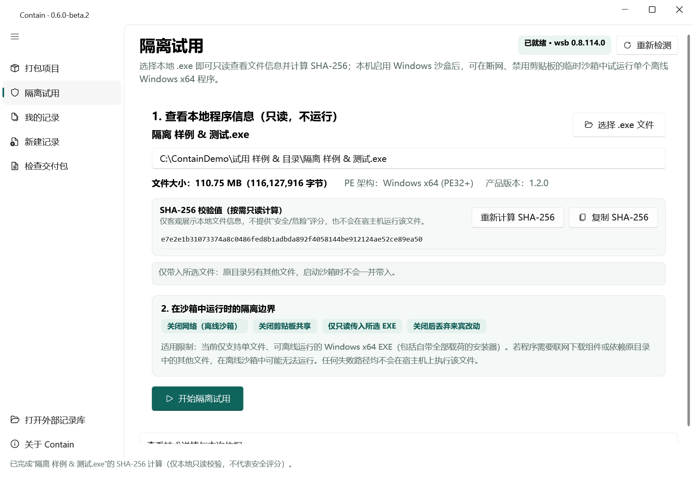
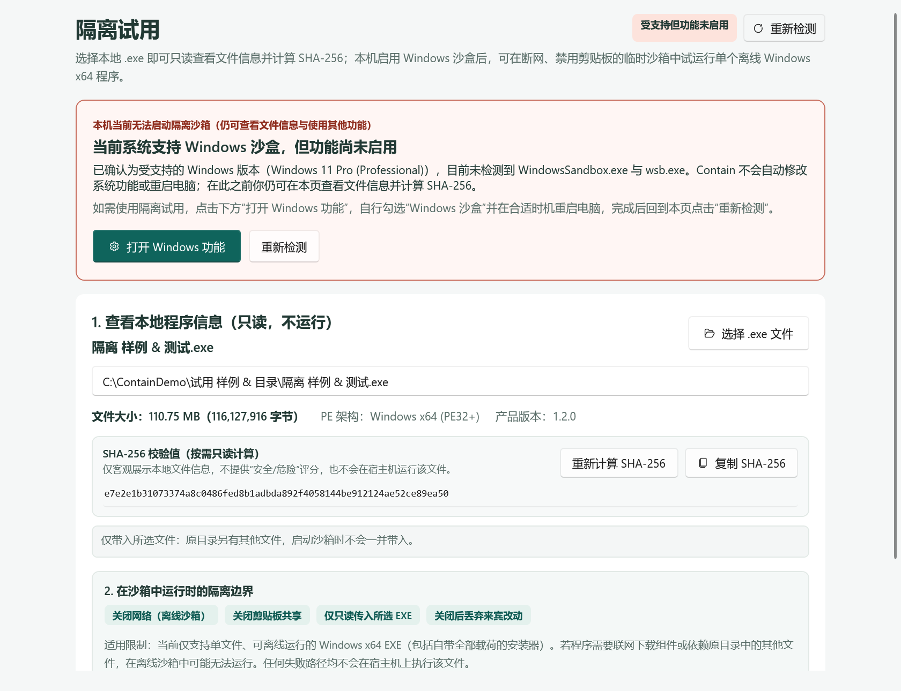
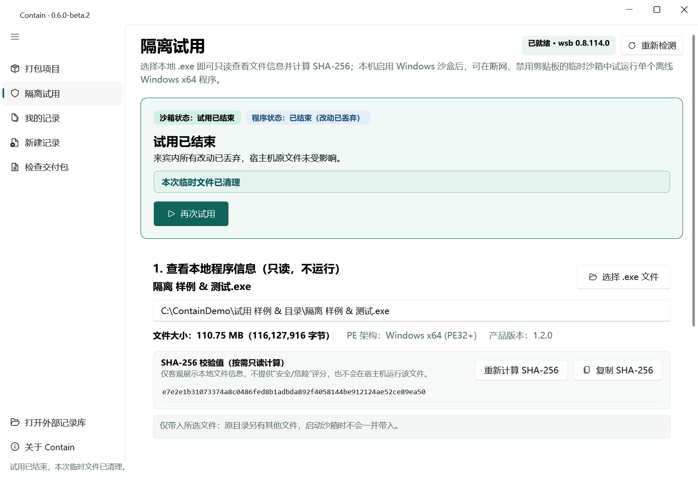

# Contain v0.6.0-beta.2 候选版「隔离试用」验收记录

> 状态：**候选试运行（Draft PR #31，未发布 GitHub Release）**。公开稳定版继续为 `v0.5.0`。

## 1. v0.6.0-beta.2 核心改进

1. **无需 Windows 沙盒即可安装、打开和使用 Contain**：
   - 安装与启动均不要求 Windows Sandbox，仅在用户进入「隔离试用」页时才以普通用户权限执行能力探测；「打包项目」「我的记录」「检查交付包」保持独立可用。
   - 修复了未找到 `WindowsSandbox.exe` / `wsb.exe` 时一律归为“未启用”的问题。基于非提权直接证据精确区分：**已就绪**、**受支持但功能未启用**、**家庭版不支持**、**沙盒可用但缺少所需 `wsb` 命令**、**硬件虚拟化未开启**（仅在 `HypervisorPresent == false` 且 `PF_VIRT_FIRMWARE_ENABLED == false` 同时成立时提示，避免 Hyper-V 运行时误报）、**系统策略阻止**、**等待系统重启生效**以及**原因尚未确定**（权限不足时如实说明，不做猜测）。
   - 每种状态提供一个明确的主要操作：受支持但未启用时提供「打开 Windows 功能」（打开 `optionalfeatures.exe`，由用户自行决定是否勾选及何时重启，随后可点「重新检测」）；家庭版直接说明可用功能并提供「前往打包项目」。任何失败路径均不会在宿主机启动所选 EXE。
2. **无沙盒环境也能只读查看本地 `.exe` 与按需计算 SHA-256**：
   - 将「1. 查看本地程序信息（只读，不运行）」与「2. 在沙箱中运行」解耦：即使本机不能启用沙盒，或选中 ARM64 程序，仍可只读查看文件名、大小、PE 架构、可获得的产品版本，并按需异步计算和复制 SHA-256。
   - 计算哈希时界面保持响应；切换或清空文件立即取消在途任务并按单调世代号丢弃旧结果，防止旧哈希串到新文件。界面明确声明仅展示本地文件信息，不提供“安全/危险”评分。
3. **简洁宿主结果页与示例程序可读性改进**：
   - 当前会话与结束结果卡置顶显示；结束后优先突出「试用已结束」「本次临时文件已清理」（若清理失败或未确认，则以警示样式如实提示）与「再次试用」。实例 UUID、PID、`ExistingLogin`、来宾路径和完整时间线收纳至折叠态的「查看技术详情与本次依据」。
   - 原目录存在其他文件时改为普通中性说明「仅带入所选文件：原目录另有其他文件，启动沙箱时不会一并带入。」；仅对真正影响操作的异常（如非 PE、ARM64 无法在 x64 沙箱运行、沙盒不可用或清理异常）使用警告样式。
   - 无害示例 GUI 程序启动时检测来宾可用字体（优先选用 `Microsoft YaHei UI`，无中文字体时自动回退可读英文，避免方块乱码）；默认视图以简短可读短句展示结果（如「输入目录：只读验证通过」），将 `UnauthorizedAccessException` 等原始异常留在可折叠详情中。
   - `README.md` 下载入口附近已写明使用 Contain 本身无需 Windows 沙盒。

## 2. 候选构建身份

- **候选版本**：`0.6.0-beta.2`（核心采集模块保持 `0.3.2-beta.10`）
- **候选包构建提交 SHA**：`45fb6307115a3144c598702eeeca4038b8c69bbf`
- **便携解压即用 ZIP**：`contain-0.6.0-beta.2-windows-x64.zip`（71,276,901 字节）
  - SHA-256：`f184f9a6fe5f5f6ce4b1b58eb1d927f89a45ebf9ce2b2b8224c9dbb2901324ea`
- **桌面安装包 Setup**：`Contain-Setup-0.6.0-beta.2-x64.exe`（51,398,910 字节，Inno Setup 6.7.3，当前用户最低权限安装，未签名候选包）
  - SHA-256：`36cd6194d79e55bdfbc52616d4947e5faa33a9b851699a8326f49116d6b93c49`

## 3. 真实 Windows 11 x64 验收（非模拟）

### 3.1 已启用 Windows 沙盒宿主机真机验收（完整解压候选 ZIP 后运行 `Contain.Viewer.exe`）

| 验收项 | 实际结果 |
| --- | --- |
| 窗口标题与首次启动落点 | 通过：`Contain · 0.6.0-beta.2`，全新 `LOCALAPPDATA` 首次进入「打包项目」 |
| 「隔离试用」能力探测 | 通过：`已就绪 · wsb 0.8.114.0`（保留异步非阻塞 `wsb connect`、精确实例 ID 跟踪与 60 秒有界超时） |
| 选文件与只读元信息 + 按需 SHA-256 | 通过：选中 `试用 样例 & 目录\隔离 样例 & 测试.exe`，显示 `110.75 MB`、`Windows x64 (PE32+)`、`产品版本：1.2.0`、中性提示「仅带入所选文件……」；按需计算并复制的 SHA-256 与宿主机实算值完全一致（`e7e2e1b31073374a8c0486fed8b1adbda892f4058144be912124ae52ce89ea50`） |
| 会话 1 启动、隔离与示例可读字体 | 通过（实例 `d9102968-abaa-4df7-9ec5-c4b6b1b2d643`）：快速 3 连点仅建 1 实例；来宾核验通过 `run_path+fresh=100`、`ro+no_sibling=101`、`offline=102`、`clipboard=103`、`readable_font=105`（选用 `Microsoft YaHei UI`、`zh-CN`） |
| 直接关闭沙箱窗口 → 简洁结果页 | 通过：关闭窗口后约 2 秒内自动显示「试用已结束」「本次临时文件已清理」与「再次试用」按钮，实例与暂存目录归零 |
| 点击「再次试用」→ 会话 2 旧标记消失 | 通过（新实例 `96a7226b-04f9-43b8-b133-85c40b8ea832`）：会话 1 的 `C:\ContainTrialMarker\session-marker.txt` 在会话 2 启动前已完全消失（`marker_existed_before == false`，退出码 `100`）；点击「结束试用」干净结束 |
| 宿主机文件完整性与定向回归 | 通过：测试前后示例 EXE SHA-256 一致；「打包项目」「我的记录」「检查交付包」切换与主窗口正常退出（退出码 0）无回归；同包 `contain.exe --read-only` 解释 `samples\viewer-demo.db` 中 `synthetic-finished-event-0` 通过 |

### 3.2 无 Windows 沙盒的干净 Windows x64 来宾环境实测（不改动宿主机配置）

在未启用 Windows Sandbox（无 `WindowsSandbox.exe`、无 `wsb.exe`）的干净断网 Windows x64 来宾环境中直接实测本轮候选包：

1. **解压版 `Contain.Viewer.exe` 无沙盒运行**：
   - 无需沙盒正常打开 `Contain · 0.6.0-beta.2`；
   - 进入「隔离试用」准确识别为 **「受支持但功能未启用」**（`当前系统支持 Windows 沙盒，但功能尚未启用`），显示 **「打开 Windows 功能」** 按钮；
   - 选中 `隔离 样例 & 测试.exe` 后可正常查看大小、PE x64 架构与 `产品版本：1.2.0`，按需计算并复制出准确 SHA-256（`e7e2e1b31073374a8c0486fed8b1adbda892f4058144be912124ae52ce89ea50`），「开始隔离试用」保持禁用；
   - 「打包项目」「我的记录」「检查交付包」均可独立切换并正常退出（退出码 0）。
2. **`Contain-Setup-0.6.0-beta.2-x64.exe` 离线安装、启动与卸载冒烟**：
   - 在干净断网无沙盒环境静默安装退出码 `0`，安装版本为 `0.6.0-beta.2+45fb6307115a3144c598702eeeca4038b8c69bbf`（`contain-workflow 0.6.0-beta.2`），无沙盒直接启动 `Contain.Viewer.exe` 正常，随后静默卸载退出码 `0` 且程序文件与快捷方式均干净移除。

## 4. 三张核心界面截图（标明真机 / 模拟来源）

1. **环境已就绪（真机状态：`wsb 0.8.114.0` + 真实文件元信息与实时 SHA-256 计算）**

2. **环境不可用但仍可查看文件（能力状态模拟“受支持但功能未启用”，文件解析与 SHA-256 为真机本地实算；同款流程另已在无沙盒干净 Windows 来宾中端到端实测通过）**

3. **会话结束后的简洁结果页（真机状态：完整沙盒会话结束后，顶部优先呈现「试用已结束」「本次临时文件已清理」「再次试用」，技术细节收进下方折叠区）**

## 5. 确定性模型与自动化测试（合成 / 模拟）

- `Contain.Desktop.Model.Tests`：**74/74 通过**（其中 11 项 `isolated_trial` 覆盖全部 8 类环境分类分支：已就绪、受支持未启用、家庭版不支持、缺少 `wsb` 命令、硬件虚拟化未开启、策略阻止、等待重启、权限不足/原因尚未确定；无沙盒查看文件与打开 Windows 功能委托；大文件异步 SHA-256 切换文件防旧值串扰；ARM64 只读查看且禁跑；清理失败如实警示；并发防重入、外部关窗检测与失败回滚恢复）。
- `scripts/test-package-source-desktop.py`（10/10）、`scripts/check-fuzz-lock.py`、`cargo test --workspace --locked`、`cargo deny --locked check` 全部通过。

## 6. 尚未在物理真机实测的分支（已由确定性测试覆盖）

- **Windows 家庭版物理机**、**BIOS 关闭硬件虚拟化物理机**、**受组策略禁用 MappedFolders / Sandbox 的域控设备**以及**普通用户注册表读取受拒绝环境**：当前宿主机保留已验收配置，未改动系统状态，上述分支均通过纯数据分类器与 ViewModel 确定性测试覆盖。
