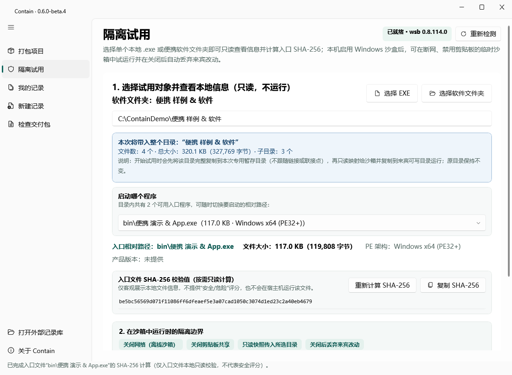
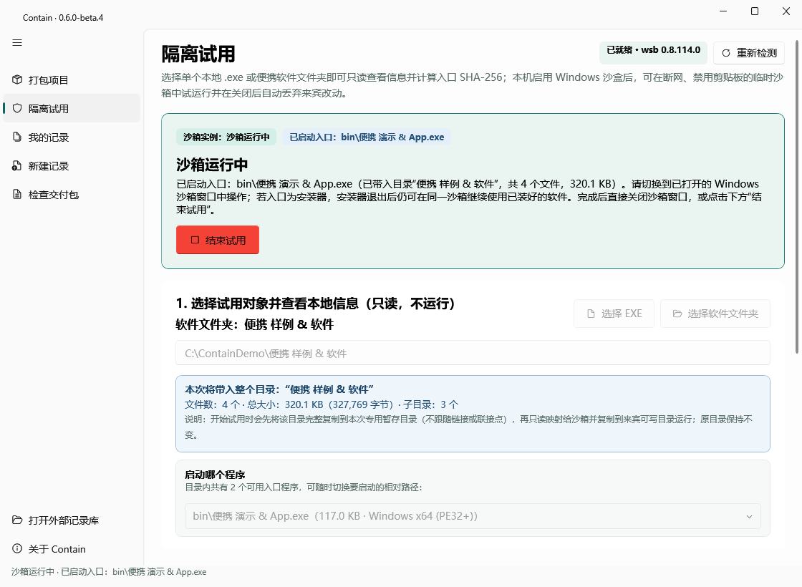

# Contain v0.6.0-beta.4 候选版「隔离试用」验收记录

> 状态：**候选试运行（Draft PR #31，未发布 GitHub Release）**。公开稳定版继续为 `v0.5.0`。

## 1. v0.6.0-beta.4 核心改进（便携软件文件夹隔离试用 + 活跃状态文案修正）

1. **双入口「选择 EXE」与「选择软件文件夹」，共用一套沙箱会话控制器**：
   - 保留原有单文件 `.exe` 简洁体验，同时新增「选择软件文件夹」入口；粘贴路径输入框同步支持单文件 `.exe` 与本地目录。
   - 异步扫描所选目录（保持界面响应并支持取消），明确展示文件夹名称、将带入的文件数、子目录数与总大小，并在「启动哪个程序」中按**相对路径**列出所有符合架构范围的 Windows x64/x86 入口（支持子目录入口及不同子目录下的同名 EXE）：
     - 仅有 1 个可用入口时自动选中并允许切换目录重新选择；
     - 有多个可用入口时禁用「开始隔离试用」直至用户显式选定相对路径；
     - 没有可用入口时给出具体原因（如目录为空或仅发现 ARM64 可执行文件）。
   - 文件夹模式下，原有按需 SHA-256 明确标注为 **「入口文件 SHA-256 校验值（按需只读计算）」**，切换入口时立即取消旧任务并清空旧值。
2. **多文件完整快照复制、安全边界与来宾子目录工作目录运行**：
   - 将用户明确选择的目录完整复制到本次专用暂存目录（保留相对目录结构与空子目录），仅在暂存快照复制并逐文件核验字节完整性后才启动沙箱。
   - **重解析点零容忍**：扫描与暂存复制两阶段均严格拦截目录符号链接、联接点或其他重解析点，并校验入口必须位于所选目录内，保证实际带入沙箱的范围与界面展示完全一致。
   - 复制较大目录时实时上报文件数与字节进度并支持 **「取消准备」**；遇到用户取消、文件不可读、复制不完整或暂存盘空间不足时立即清理本次暂存、明确标注失败阶段且绝不启动沙箱。
   - 沙箱只读映射该暂存快照后，来宾启动脚本将整个目录复制到可写本地路径 `C:\ContainTrialRun`，并**以入口 EXE 所在子目录作为工作目录**运行，使旁侧 DLL、相对路径资源与程序旁本地设置按普通便携软件方式正常工作。
3. **修正真实 7-Zip 流程暴露的活跃状态文案**：
   - 活跃会话主标题与沙箱徽标统一改为 **「沙箱运行中」**，动作徽标改为 **「已启动入口：<相对路径或文件名>」**，仅呈现实际观察到的启动动作，不再在安装器退出后造成语义歧义，并在摘要中说明安装器退出后仍可在同一沙箱继续使用已装好的软件（不增加额外持续枚举来宾进程的服务）。

## 2. 候选构建身份

- **候选版本**：`0.6.0-beta.4`（核心采集模块保持 `0.3.2-beta.10`）
- **候选包构建提交 SHA**：`f953b41b9f1e8d724d64a087e85c0be8151ca5d6`
- **便携解压即用 ZIP**：`contain-0.6.0-beta.4-windows-x64.zip`（71,322,681 字节）
  - SHA-256：`0fe84772c9d80c4240ecd3d14b67ced0abd925823cd2e1ae692ea5df5c23e64b`
- **桌面安装包 Setup**：`Contain-Setup-0.6.0-beta.4-x64.exe`（51,426,476 字节，Inno Setup 6.7.3，`AppId={8F4E2D91-5C3A-4B7E-9A16-2D8C4E7F1035}`，当前用户最低权限安装，未签名候选包）
  - SHA-256：`aac43844dc1e193f3afb4c918918a4a800be3769349f523f186b618794e701a8`

## 3. 真实 Windows 11 x64 验收（解压最终候选 ZIP 通过正常桌面入口实测）

测试全程通过 `CONTAIN_VIEWER_TEST_ROOT` 隔离在独立目录，未触碰宿主机个人记录库与已有程序安装。

### 3.1 区分 Beta.3 与 Beta.4 的可审阅便携样例（`便携 样例 & 软件`）

样例结构（纯原生 x64 Win32 `/MT` 编译，共 4 文件，`327,769` 字节，含中文、空格、`&` 与嵌套子目录）：
- `bin\便携 演示 & App.exe`（硬链接导入旁侧 `PortableResourceLib.dll`，从相对路径 `..\assets\banner.txt` 读取特定文本，并提供界面按钮将 `user-settings.ini` 保存到程序旁）
- `bin\PortableResourceLib.dll`
- `assets\banner.txt`
- `tools\辅助工具.exe`（第二个子目录入口，用于实测多入口相对路径选择）

| 验收项 | 实际结果 |
| --- | --- |
| 1A. 仅用单 EXE 模式运行 `bin\便携 演示 & App.exe`（Beta.3 能力边界） | 通过验证差距（实例 `6230dde2-13ae-42ea-9f52-a247a260b3a1`）：来宾内无 `PortableResourceLib.dll`，便携样例窗口未能打开（退出码校验 `110`），单文件模式无法完成样例操作 |
| 1B. 改用文件夹模式选择 `便携 样例 & 软件` 与 `bin\便携 演示 & App.exe` | 通过（实例 `f8a9f1f0-87b2-4ae1-96cc-83cf45fbd25a`）：界面展示 `本次将带入整个目录：“便携 样例 & 软件”`、`4 个文件 / 320.1 KB / 3 个子目录`；存在 2 个入口时未选入口前禁用「开始隔离试用」；选中 `bin\便携 演示 & App.exe` 后入口 SHA-256 与宿主实算一致；启动后 Contain 显示 `沙箱运行中` 与 `已启动入口：bin\便携 演示 & App.exe`；来宾内成功打开 `Contain 便携样例 · 多文件运行验证` 窗口、经 `PortableResourceLib v1.4` 读出 `CONTAIN-BETA4-RESOURCE-OK`、工作目录为 `C:\ContainTrialRun\bin`、点击界面按钮成功写出 `user-settings.ini`（退出码校验 `111`） |
| 1B 关窗与宿主源目录对比 | 通过：直接关闭沙箱窗口后 Contain 自动切至「试用已结束」「本次临时文件已清理」；宿主机源目录 `便携 样例 & 软件` 仍严格为原 4 个文件（无 `user-settings.ini`）且全部文件 SHA-256 与测试前逐字节一致 |
| 1C. 点击「再次试用」核验上次保存的设置消失 | 通过（新实例 `cdd4384e-5fca-4575-b495-6d65b4697861`）：来宾核验 `C:\ContainTrialRun\bin\user-settings.ini` 已消失且 `assets\banner.txt` 仍在（退出码校验 `112`）；通过「结束试用」干净收尾 |

### 3.2 真实多文件软件验收（只读复制宿主机已有 7-Zip 程序目录）

| 验收项 | 实际结果 |
| --- | --- |
| 扫描与入口选择 | 通过：选中只读复制的 `7-Zip 便携目录`（`106` 个文件、`5.63 MB`、`1` 个子目录），在多个可用入口中选中 `7zFM.exe` |
| 来宾运行、压缩解压与宿主隔离 | 通过（实例 `cf6d13a9-5cf5-4c77-a717-5f5c2bb573d8`）：Contain 显示 `沙箱运行中` 与 `已启动入口：7zFM.exe`；来宾内 `7zFM.exe` 窗口随旁侧 `7z.dll` 正常运行，新建测试文本压缩为 `.7z` 并解压比对内容与 SHA-256 逐字节一致（退出码校验 `113`）；直接关窗后自动清理，宿主源目录副本全部 106 个文件哈希不变、宿主机不存在测试目录且原安装未受影响 |

### 3.3 原单 EXE 流程与 Beta.3 异常退出恢复回归

| 验收项 | 实际结果 |
| --- | --- |
| 单 EXE + 强杀恢复回归 | 通过（实例 `7b2fdd05-dcc4-4f44-8f60-9af6c5480988`）：选择 `隔离 样例 & 测试.exe` 启动显示 `沙箱运行中` 与 `已启动入口：隔离 样例 & 测试.exe`；仅强杀 `Contain.Viewer.exe` 后沙箱保持存活；重新打开同 Beta.4 候选版出现非阻塞横幅与「上次试用仍在运行」，点击「结束这次试用」后回到「试用已结束」「本次临时文件已清理」，窗口正常退出（退出码 `0`），`wsb list`、暂存目录与 `pending-session.json` 归零，原示例 EXE SHA-256 不变 |

## 4. 两张核心界面实拍截图（均为真机运行状态）

1. **选择软件目录和入口（真机状态：`wsb 0.8.114.0` 扫描真实便携目录，展示带入范围、2 个可选入口相对路径、已选 `bin\便携 演示 & App.exe` 及入口文件实算 SHA-256）**

2. **多文件程序在沙箱中运行（真机状态：真实沙箱实例 `eddb4139-04dd-49c3-83e8-b3a11e4121ff` 正在运行，顶部展示「沙箱运行中」与「已启动入口：bin\便携 演示 & App.exe」及安装器退出后可继续使用的说明）**

## 5. 确定性模型与自动化测试（合成 / 模拟）

- `Contain.Desktop.Model.Tests`：**82/82 通过**（在 Beta.3 的 77 项基础上新增 5 项 Beta.4 专项测试）：
  1. 含中文/空格/`&` 的嵌套便携目录扫描、单入口自动选中、完整目录树暂存快照与入口 SHA-256 显式标注；
  2. 不同子目录下**同名 EXE**（`app\Tool.exe` 与 `tools\Tool.exe`）相对路径区分、切换入口清除旧 SHA-256、以及空目录/仅 ARM64 目录说明原因并禁用启动；
  3. 真实 NTFS 目录联接点（`mklink /J`）在扫描与暂存复制两阶段均被拒绝，以及 `..`/绝对路径入口穿越拒绝；
  4. 暂存复制阶段点击「取消准备」立即中止、清理部分暂存且绝不启动沙箱；
  5. 独占锁定不可读文件与暂存盘空间不足均在「准备输入快照」阶段明确报错并清理暂存、不启动沙箱。
- `cargo test -p contain-workflow --locked`（55/55）、`scripts/test-package-source-desktop.py`（10/10）、`scripts/check-fuzz-lock.py`、`cargo deny --locked check` 与全库卫生扫描全部通过。

## 6. 延续的 Beta.2 / Beta.3 验收基础

`v0.6.0-beta.2` 与 `v0.6.0-beta.3` 已验证的离线 `v0.5.0 → v0.6.0` 原位升级与个人记录库保留、无沙盒环境只读查看与 8 类非提权能力分类、以及结束状态双事实分离确认机制均在 `v0.6.0-beta.4` 完整保留（历史截图留存于 `docs/v0.6.0-beta.2/` 与 `docs/v0.6.0-beta.3/`）。
