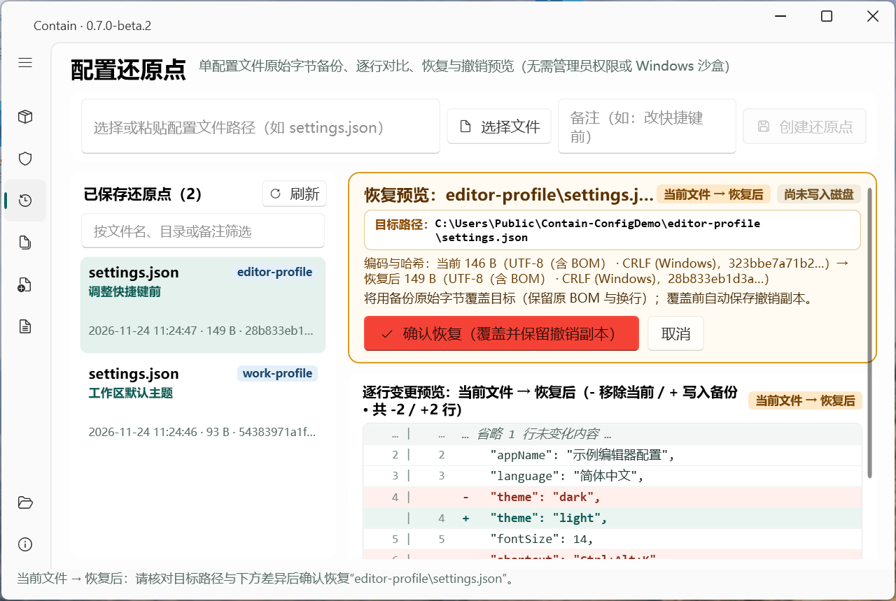
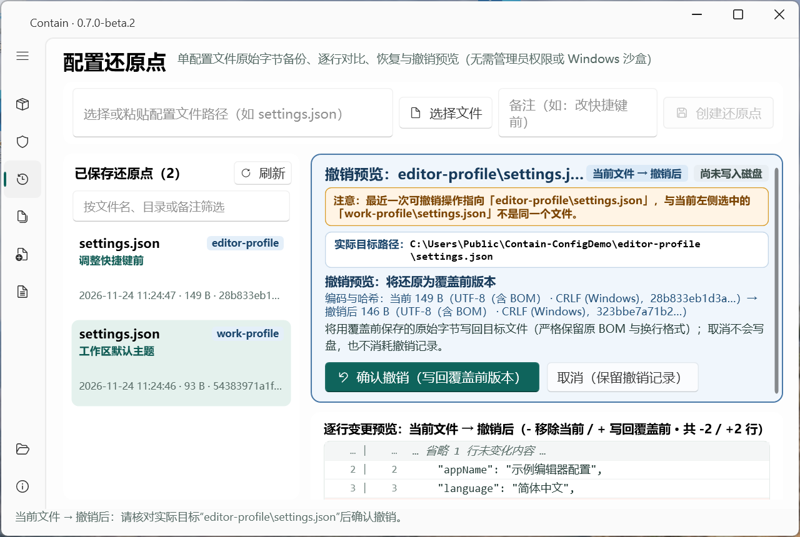

# Contain v0.7.0-beta.2「配置还原点 · 恢复与撤销预览」候选版验收记录

> 状态：**Windows x64 可安装试用候选版（`feat/config-restore-points` Draft PR #32，未合并、未打 Tag、未公开发布）**。当前公开稳定版为 `v0.6.0`。

## 1. Beta.2 增量范围与设计边界

沿用 Beta.1 的单文件还原点、原始字节备份与本地历史格式（`%LOCALAPPDATA%\Contain\ConfigRestorePoints`，无需管理员权限或 Windows Sandbox），本轮重点补齐恢复与撤销两个操作前后的方向一致性、防误操作预览与实时冲突保护：

- **操作跟随的差异方向**：
  - 普通浏览页保持 **「从备份到现在」**（`-` 备份原有行 / `+` 当前文件新增行），帮助用户回顾自上次备份以来的修改。
  - 进入「恢复预览」后，差异方向自动切换为 **「当前文件 → 恢复后」**（`-` 即将移除的当前内容 / `+` 即将写回的备份内容），连同增删计数、字节数、SHA-256 及编码/BOM/换行信息一并按恢复方向生成（例如当前 `dark`、备份 `light` 时显示移除 `dark`、写入 `light`）。
  - 高 DPI（如 150% 缩放、`1280×860`）下，恢复预览卡片精简重复信息，确保完整目标路径、方向徽章、确认/取消按钮及关键逐行差异同屏首屏可读。
- **轻量撤销预览与跨文件防误操作**：
  - 点击撤销不再直接写盘，而是先进入轻量 **「撤销预览」**，显式展示实际目标完整路径、方向徽章 **「当前文件 → 撤销后」**、字节/编码/哈希变化与逐行差异（或缺失重建后的移除预告）。
  - 当最近一次可撤销操作指向的文件与左侧当前选中的同名不同目录文件不一致时（例如可撤销对象为 `editor-profile\settings.json`，左侧已切到 `work-profile\settings.json`），顶部撤销条、撤销按钮文案与撤销预览顶部均显式标明实际将被修改的目标并给出跨文件提醒。
  - 点击「取消（保留撤销记录）」不写盘，也不消耗该条撤销记录。
- **撤销前的存在性与内容双重核对**：
  - 进入撤销预览与点击「确认撤销」写盘/删除前两次实时核对目标文件的存在性与 SHA-256：
    - 恢复后若目标被外部修改（A → C），立即阻断撤销、保留用户最新内容 C、说明冲突并禁用确认按钮，不静默消耗撤销记录。
    - 恢复后若目标被用户主动删除（删 A），明确识别为 **「目标文件已被主动删除」** 并阻断撤销，保持文件已删除状态（不错误复活旧文件），同时不消耗撤销记录。
    - 对原本不存在、由恢复重建的文件，若重建后未再被改动，撤销预览明确预告 **「将移除本次重建的文件」**，仅在用户确认后执行移除。

## 2. 候选构建身份

- **候选版本**：`0.7.0-beta.2`（PE / 程序集版本 `0.7.0.2`；采集核心沿用 `contain 0.3.2-beta.10`）
- **最终构建提交 SHA**：`c87fe677820f4f9faf18b6a93910fa125b360159`（后续仅追加本验收文档与截图，不改产品代码与构建输入）
- **签名状态**：`NotSigned`（未做代码签名）

| 候选产物 | 大小（字节） | SHA-256 | 说明 |
| --- | ---: | --- | --- |
| `contain-0.7.0-beta.2-windows-x64.zip` | 71,451,560 | `2540c5995aea82da333f13e86c3d4bfbeaee7f846ea2c5e5d7a5542ec19f72e5` | 便携解压即用桌面包（723 个载荷文件） |
| `Contain-Setup-0.7.0-beta.2-x64.exe` | 51,531,722 | `51c68b7d5fa7fb617541038f0c9bab9d299eef360f1b1461a3711a194f7caa66` | 当前用户最低权限安装器（Inno Setup `6.7.3`，`FileVersion=0.7.0.2`） |

## 3. 真实 Windows 11 实拍界面截图

两张截图均在断网、未启用 Windows Sandbox 的干净 Windows 11 环境中安装 `Contain-Setup-0.7.0-beta.2-x64.exe` 后按高 DPI 比例（`1280×860`）实拍：

### 3.1 恢复预览（「当前文件 → 恢复后」）

同屏清晰呈现目标路径（`editor-profile\settings.json`）、方向标签 **「当前文件 → 恢复后」**、字节/编码/哈希变化、确认/取消按钮，以及首屏直接可见的 `- "theme": "dark",` / `+ "theme": "light",` 逐行变更：

### 3.2 撤销预览与跨文件同名提醒（「当前文件 → 撤销后」）

在左侧已切换选中另一目录同名文件 `work-profile\settings.json` 的情况下，点击撤销后顶部明确提示实际目标为 `editor-profile\settings.json`（而非左侧当前选中项），并给出完整实际路径、方向标签 **「当前文件 → 撤销后」**、以及不写盘不消耗记录的取消选项：

## 4. 真实 Windows 11 实机验收结果（`c87fe67` 最终候选包）

宿主机实测通过 `CONTAIN_VIEWER_TEST_ROOT` 与独立临时演示目录隔离，未触碰个人记录库；离线安装实测在断网无沙箱 Windows 11 环境中完成。

| 验收场景 | 被测产物 | 实测结果 |
| --- | --- | --- |
| 1. 恢复预览（`dark → light`）与撤销预览（`light → dark`）+ 取消不写盘不消耗 | 最终 ZIP 解压版 + 离线 Setup 安装版 | **全部通过**：UTF-8 含 BOM · CRLF 含中文 `settings.json`（备份 A=`light` `28b833eb1d3a7d5e87fa87a8cb86556f488212572b0f834889030ea8134b26df`，当前 B=`dark` `323bbe7a71b290e1360bb8eba99ae5a2b9853dc3b1af3ddb72a9197860a4c418`）。浏览页显示「从备份到现在」（`- light` / `+ dark`）；恢复预览切换为「当前文件 → 恢复后」（`- dark` / `+ light`），确认后磁盘 SHA-256 严格等于 A；撤销预览显示「当前文件 → 撤销后」（`- light` / `+ dark`），点击取消后磁盘保持 A 且未消耗撤销记录仍为 `1` 条；重新打开撤销预览并确认后磁盘 SHA-256 严格回到 B，撤销记录标记已消耗（未消耗 `0` 条） |
| 2. 恢复后外部修改（A → C）冲突阻断 | 最终 ZIP 解压版 | **通过**：① 恢复至 A 后在外部修改为 C（`13092d879e43c34c267b0b71a05134e49be48aed29388727cb774bf5862b6bef`）再点撤销，预览显示「撤销冲突：恢复后目标文件已被外部修改」并禁用确认按钮，C 原样保留；② 在打开正常的撤销预览后、确认前中途外部改为 C，点击确认触发二次实时校验并显示「撤销已阻止：恢复后目标文件又被外部修改」，C 逐字节保留且撤销记录仍未消耗 |
| 3. 恢复后主动删除（删 A）冲突阻断 | 最终 ZIP 解压版 | **通过**：① 恢复至 A 后主动删除该文件再点撤销，预览显示「撤销冲突：恢复后目标文件已被主动删除」并禁用确认按钮，文件保持已删除状态；② 打开正常撤销预览后中途删除 A 再点确认，触发二次实时校验并显示「撤销已阻止：目标文件已被主动删除」，文件保持已删除（未复活旧文件） |
| 4. 原本缺失文件经恢复重建后再撤销 | 最终 ZIP 解压版 | **通过**：对已删除的 `missing-demo\settings.ini` 确认恢复后按原始字节重建（SHA-256 `8391d41cda5d5553f09f36d4d8908e41d2500c321fb0bb49a986957e3b481dc2`）；打开撤销预览明确显示「撤销预览：将移除本次重建的文件」，预览与取消期间文件保持存在；确认撤销后精准移除该重建文件 |
| 5. 切换左侧到另一目录同名文件时的撤销防误操作 | 最终 ZIP 解压版 + 离线 Setup 安装版 | **通过**：对 `editor-profile\settings.json` 执行恢复后，左侧切换选中 `secondary-profile\settings.json`（实拍为 `work-profile\settings.json`）；顶部撤销区显示跨文件提醒与显式按钮「撤销对 `editor-profile\settings.json` 的恢复…」，预览目标路径明确指向 `editor-profile\settings.json`；确认撤销后仅 `editor-profile\settings.json` 回到 B（`323bbe7a…`），`secondary-profile\settings.json` 逐字节未触碰（`1bc6e8b5815aab424399cebe545a4c5ad2922a4e975f02cfe63ad751d37a6212`） |
| 6. 离线无沙箱 Setup 安装、恢复/撤销闭环与卸载 | `Contain-Setup-0.7.0-beta.2-x64.exe` | **通过**：断网无开发工具、未启用 Windows Sandbox 的 Windows 11 环境中普通用户静默安装（`DisplayVersion = 0.7.0-beta.2`），完成重启对比、双预览实拍、恢复 A、跨文件撤销 B 与干净卸载（`exit 0`） |

## 5. 确定性模型与自动化回归（构建提交 `c87fe67`）

- `Contain.Desktop.Model.Tests`：**111 / 111 通过**（含 12 项配置还原点回归，新增覆盖恢复方向 `CurrentToBackup` vs 浏览方向 `BackupToCurrent`、轻量撤销预览、取消不写盘不消耗、外部修改 A→C 冲突、主动删除 A 冲突、预览中途修改/删除二次拦截、跨目录同名文件撤销指向与缺失重建移除预告）。
- `Contain.Desktop` Release 构建：**0 warnings，0 errors**。
- `cargo test -p contain-workflow --locked`：**55 / 55 通过**。
- `scripts/test-package-source-desktop.py`：**10 / 10 通过**。
- `scripts/check-fuzz-lock.py`、`cargo deny --locked check` 与全库卫生扫描：**全部通过**。

## 6. Beta.1 基线保留记录

- Beta.1 基线候选构建提交：`ab8a1dce76ae5c7d7442544dbc316dd239205f97`（原始单文件还原点、同名不同目录区分、确认期外部编辑拦截、文件锁定写入失败保护与备份损坏检测已在 Beta.1 全量实测通过，历史截图保留于 `docs/v0.7.0-beta.1/contain-v070b1-restore-confirm.png`）。
