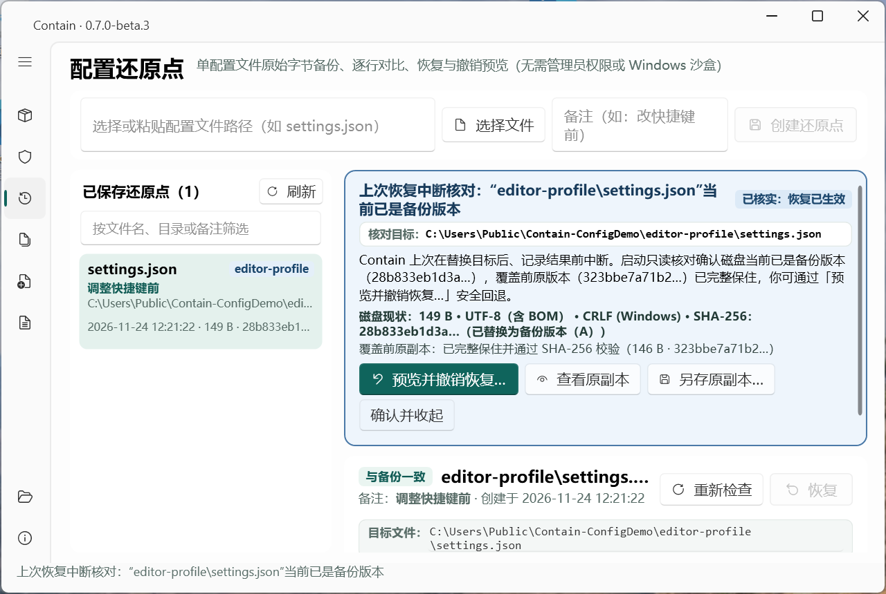
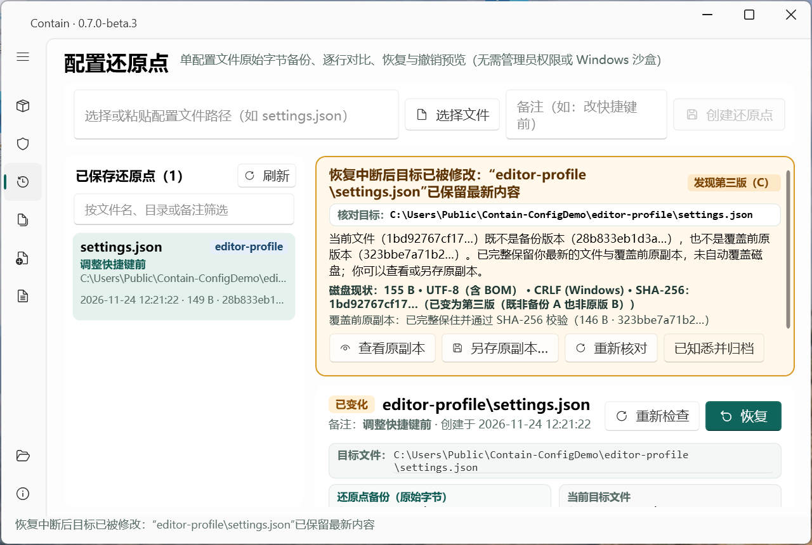

# Contain v0.7.0-beta.3「配置还原点 · 恢复中断后保住原配置」候选版验收记录

> 状态：**Windows x64 可安装试用候选版（`feat/config-restore-points` Draft PR #32，未合并、未打 Tag、未公开发布）**。当前公开稳定版为 `v0.6.0`。

## 1. Beta.2 边界复核结论（区分实测结果与源码推断）

在修改代码前，基于冻结的 Beta.2 构建（`c87fe677820f4f9faf18b6a93910fa125b360159`）对两个高风险中断边界进行了可控复核（均使用 `A=light` `7c622019…`、`B=dark` `4248206e…` 的 UTF-8 含 BOM · CRLF 临时文件与独立数据目录）：

| 复核边界 | 验证方式 | 磁盘目标哈希 | B 的副本是否在 | 重开 Beta.2 界面提供什么操作 |
| --- | --- | --- | --- | --- |
| 边界 1a：目标替换成 A 后，写后回读校验失败 | **可控故障注入复现（精确复刻 Beta.2 `c87fe67` `RestoreFromPoint` `try/catch`）+ 无修改冻结 Beta.2 重开实测** | `7c622019…`（已是 **A**） | **已被删除（永久丢失 B）** | 状态显示「当前文件与备份完全一致」，**无撤销入口**，「恢复」禁用，仅剩「重新检查 / 刷新」 |
| 边界 1b：目标替换成 A 后，刷新比较失败 | **可控故障注入复现（同上）+ 无修改冻结 Beta.2 重开实测** | `7c622019…`（已是 **A**） | **已被删除（永久丢失 B）** | 同上（无撤销入口，原版本 B 无法找回） |
| 边界 2：撤销已写回 B 后，完成标记保存失败 | **无修改冻结 Beta.2 DLL 实测**（撤销确认前对 `Undo/<id>.json` 加 `FileShare.Read` 锁触发 `File.Move` 失败） | `4248206e…`（已是 **B**） | **仍在**，且 `consumed=false` | 同会话横幅误报「已撤销本次恢复」却仍保留撤销条；重开后仍显示过期撤销条「撤销对 `app\settings.json` 的恢复…」，点击进入预览后误报 `TargetModifiedConflict`（「恢复后目标文件已被外部修改」）并永久卡住 |
| 附加复核：B 副本已存、目标未替换即崩溃（时刻 1） | **无修改冻结 Beta.2 重开实测** | `4248206e…`（仍是 **B**） | 仍在（`consumed=false`） | 重开后错误显示撤销条「可撤销对 `app\settings.json` 的上次恢复」（虚假成功恢复） |

**源码推断补充（`ConfigRestorePointService.cs` @ `c87fe67`）**：
- 第 826–852 行将 `SafeWriteRawBytesToTarget`、`ComputeFileSha256Hex`（无内部捕获且在哈希不符时显式抛 `IOException`）与 `CompareRestorePoint` 置于同一个 `try/catch` 中，且 `catch` 块无条件删除 `undoBlobPath` 和 `undoMetaPath`（第 850–851 行）；此外 `CompareRestorePoint` 内部已捕获常规 `IOException`/`UnauthorizedAccessException`，但在非预期异常时仍会落入同一破坏性 `catch`。
- 第 1269–1280 行 `MarkUndoConsumed` 静默吞掉所有异常，导致撤销已写回 B 后若元数据写入失败，外层仍报告成功且 `consumed=false` 长期残留。

## 2. Beta.3 架构修正与核心能力

1. **阶段化保存顺序与异常隔离**：
   - 在现有 `Undo/<id>.json`（`schema_version = 1`）上以向后兼容的可选字段增加 `operation_state`（`restore_prepared` / `restore_completed` / `restore_aborted` / `undo_prepared` / `undo_completed` / `archived_after_conflict`），**兼容 Beta.1/Beta.2 已有还原点与无 `operation_state` 的旧版撤销记录**。
   - **恢复路径**：先原子落盘并校验原始副本 B + `restore_prepared`；再独立 `try/catch` 替换目标 A（仅当实测证明目标仍等于覆盖前状态时才记 `restore_aborted`，目标状态变更或不可读时绝不删除 B）；写后回读校验、`restore_completed` 保存、对比刷新各自独立捕获，**任何替换后的失败均绝不删除 B 的原始副本**。
   - **撤销路径**：先落盘 `undo_prepared` 再写回 B 或移除重建文件；最后独立保存 `undo_completed`（`consumed=true`），不再静默吞掉失败，而是明确提示 `SucceededMetadataPending` 且不再展示过期撤销条。
2. **启动只读核对（永不自动写盘或删除用户文件）**：
   - 启动 Contain 时自动运行只读核对（仅读取目标文件与本地记录），根据目标是否存在、实际 SHA-256、原副本完整性和阶段标记给出明确核对卡片，并在其他页面顶部展示非阻塞提醒条。
   - **第三版 C 保护与原副本救回**：中断后若目标已被用户改为第三版 C（或主动删除），完整保留 C（或缺失状态）与 B 的原始副本，绝不盲目撤销，提供 **「查看原副本」**（只读行号预览，含 SHA-256 校验）与 **「另存原副本…」**（原子导出原始字节并拒绝直接覆盖当前目标文件）。
   - **证据不足降级为「待核对」**：当目标文件被独占锁定不可读、操作记录损坏/缺哈希或 B 副本校验失败、以及旧版无阶段标记记录与磁盘已是 B 产生歧义时，统一显示 **「待核对」**，保持目标文件零写入。

## 3. 候选构建身份

- **候选版本**：`0.7.0-beta.3`（PE / 程序集版本 `0.7.0.3`；采集核心沿用 `contain 0.3.2-beta.10`）
- **最终构建提交 SHA**：`7f3aab5536ca645ed8756caf8086dfff04704748`（后续仅追加本验收文档与截图，不改产品代码与构建输入）
- **签名状态**：`NotSigned`（未做代码签名）

| 候选产物 | 大小（字节） | SHA-256 | 说明 |
| --- | ---: | --- | --- |
| `contain-0.7.0-beta.3-windows-x64.zip` | 71,471,521 | `c222320d2fb13ff9154d43c3f1b67fa35f354db023edcba2bc6fd4ed6f07d7fd` | 便携解压即用桌面包（723 个载荷文件） |
| `Contain-Setup-0.7.0-beta.3-x64.exe` | 51,537,729 | `d5aa26ad19dff40ea21bdfff53cbd6b2b63b840e731f32c01f983363a4a8c7d1` | 当前用户最低权限安装器（Inno Setup `6.7.3`，`FileVersion=0.7.0.3`） |

## 4. 真实 Windows 11 实拍界面截图

两张截图均在断网、未启用 Windows Sandbox 的干净 Windows 11 环境中安装 `Contain-Setup-0.7.0-beta.3-x64.exe` 后实拍（`1280×860`）：

### 4.1 中断时刻 2 重开核对（「已核实：恢复已生效」）

目标已替换为备份 A、结果未记完即强杀重开后，启动只读核对确认磁盘为 A、覆盖前副本 B 已通过 SHA-256 校验，并直接提供「预览并撤销恢复…」「查看原副本」「另存原副本…」：

### 4.2 中断后外部改为第三版 C（「发现第三版（C）」）

中断后目标被外部改为第三版 C，重开完整保留 C 与原副本 B，不自动覆盖，并提供「查看原副本」「另存原副本…」「重新核对」「已知悉并归档」：

## 5. 两类验证证据（明确区分）

全部测试均使用临时文件与独立数据目录（`CONTAIN_VIEWER_TEST_ROOT`），未触碰个人记录库。

### 一类证据：确定性精确中断点测试（`Contain.Desktop.Model.Tests`，构建提交 `7f3aab5`）

通过可选生命周期钩子 `IConfigRestoreOperationHooks`（生产环境为 `null`）在精确边界注入中断，无时序碰运气，**120 / 120 全部通过**（含新增 9 项 Beta.3 专项回归）：

| 确定性测试项 | 覆盖边界与断言结果 |
| --- | --- |
| `config_beta3_boundary1_post_replace_readback_and_refresh_failure_preserve_original_b` | 目标替换成 A 后分别注入回读 `IOException` 与对比刷新异常：磁盘为 A，B 副本完整保留且 SHA-256 一致，重开均可通过撤销预览逐字节回到 B |
| `config_beta3_boundary2_undo_completion_mark_save_failure_and_idempotent_restarts` | 撤销写回 B 后注入 `undo_completed` 保存失败：诚实提示而非静默吞错、不留过期撤销条；目标加 `ReadOnly` 属性后连续重开 2 次验证零写盘（`LastWriteTimeUtc` 与 `shaB` 不变），第 1 次显示实际结果、第 2 次完全干净 |
| `config_beta3_moment1_crash_after_b_saved_before_target_replaced` | **时刻 1**（B 副本与 `restore_prepared` 已存、目标尚未替换即中断）：重开磁盘仍为 B（零写盘），状态 `RestoreNotApplied`，不显示虚假撤销条，允许重新发起恢复 |
| `config_beta3_moment2_crash_after_target_replaced_with_a_before_result_saved` | **时刻 2**（分别在替换后回读前与校验后保存前中断）：重开只读核实磁盘为 A、B 完好，通过撤销预览（`- light` / `+ dark`）确认恢复精确 B 字节 |
| `config_beta3_moment3_crash_after_undo_wrote_b_before_consumed_saved` | **时刻 3**（撤销已写回 B、`undo_completed` 未存即中断，目标置 `ReadOnly`）：第 1 次重开显示 `UndoAlreadyApplied` 实际结果，第 2 次重开干净且两次启动均零写盘 |
| `config_beta3_interrupted_then_external_edit_to_c_view_and_save_as_original_b` | `restore_prepared` / `undo_prepared` 中断后外部改为第三版 C，以及恢复中断后文件被删除：保留 C（或缺失状态）与 B 副本，内联查看 B 显示 `dark`，另存拒绝覆盖 C 自身、另存到新路径逐字节等于 B（BOM/CRLF 完整），归档后仍不删 B 副本 |
| `config_beta3_originally_missing_file_interrupted_recreate_undo_and_external_c` | 原本缺失的 `settings.ini`：重建前中断仍缺失无假恢复；重建 A 后中断重开核实 A 且撤销预览预告「移除本次重建的文件」；移除后未记完中断重开 2 次零写盘；重建后外部改 C 保留 C 不误删 |
| `config_beta3_insufficient_evidence_shows_needs_verification_without_touching_target` | 目标独占锁定不可读、损坏 JSON 元数据、B 副本损坏三种证据不足场景均显示 **「待核对」** 且零写盘；解锁后点击「重新核对」恢复为 `RestoreAppliedNeedsReview` |
| `config_beta3_backward_compatibility_with_beta1_and_beta2_points_and_undo_records` | 严格按 Beta.1/Beta.2 无 `operation_state` JSON 格式构造：① 磁盘 A 正常撤销回 B 无误报；② 磁盘 C 冲突预览同时提供查看/另存原副本 B；③ 旧版未关闭记录且磁盘已是 B 时显示「待核对」并隐藏失效撤销条 |

### 二类证据：真实 Windows 11 进程终止与重开实测（最终 `7f3aab5` 候选包）

基于最终打包的 `Contain.Viewer.exe`（`FileVersion = 0.7.0.3`）与 `Contain-Setup-0.7.0-beta.3-x64.exe` 执行真实 `Process.Kill()` 强杀重开验收，全部通过（宿主机 6 项 + 离线 Setup 1 项）：

| 实测场景 | 被测产物 | 实测结果 |
| --- | --- | --- |
| 1. 时刻 2 真实 `Kill()` 强杀与重开（`A=light` / `B=dark`） | 最终 ZIP 解压版 | **通过**：杀掉运行中的 `Contain.Viewer.exe`（PID `92224`，`exit=-1`）后启动新进程（PID `80956`）；首页顶部即出现只读核对提醒条，目标 `LastWriteTimeUtc` 与 `shaA` 未变；点击进入后显示「已核实：恢复已生效」且 B 副本通过 SHA-256 校验，经撤销预览（`- light` / `+ dark`）确认写回精确 B（`323bbe7a…`） |
| 2. 时刻 1 真实 `Kill()` 强杀与重开 | 最终 ZIP 解压版 | **通过**：重开显示「恢复未生效（原文件未变）」，无虚假撤销条，「恢复」按钮可用，目标保持 B（`323bbe7a…`）且启动零写盘 |
| 3. 时刻 3 真实 `Kill()` 强杀 + 目标只读保护双次重开 | 最终 ZIP 解压版 | **通过**：目标置 `FileAttributes.ReadOnly` 后第 1 次重开显示「已核实：撤销已生效」且无撤销条；第 2 次重开完全干净、无卡片无撤销条，两次启动目标哈希（`323bbe7a…`）与 `LastWriteTimeUtc` 零改动 |
| 4. 中断后外部改 C：内联查看 B 与归档 | 最终 ZIP 解压版 | **通过**：重开显示「发现第三版（C）」，保留 C（`1bd92767…`）无盲目撤销；点「查看原副本」展示 `dark` 且「另存原副本…」可用；归档后 C 与本地 B 副本文件（`323bbe7a…`）均完好 |
| 5. 独占锁「待核对」+ 原本缺失重建中断 | 最终 ZIP 解压版 | **通过**：独占锁定时重开显示「待核对」，解锁点「重新核对」转为「已核实：恢复已生效」；原本缺失 `settings.ini` 重建后强杀重开，撤销预览预告「将移除本次重建的文件」，确认后精准移除 |
| 6. Beta.1/Beta.2 旧版记录实机兼容 | 最终 ZIP 解压版 | **通过**：无 `operation_state` 的旧版还原点与撤销记录正常加载、无误报恢复卡片，经撤销预览精确还原 B（`323bbe7a…`） |
| 7. 断网无沙箱 Windows 11 Setup 安装、强杀重开双实拍与卸载 | `Contain-Setup-0.7.0-beta.3-x64.exe` | **通过**：静默安装（`DisplayVersion = 0.7.0-beta.3`），完成时刻 2 强杀重开与第三版 C 两张 `1280×860` 高清实拍、查看原副本与归档及干净卸载（`exit 0`） |

## 6. 全量自动化与质量门禁（构建提交 `7f3aab5`）

- `Contain.Desktop` Release 构建：**0 warnings，0 errors**。
- `Contain.Desktop.Model.Tests`：**120 / 120 通过**。
- `cargo test -p contain-workflow --locked`：**55 / 55 通过**。
- `scripts/test-package-source-desktop.py`：**10 / 10 通过**。
- `scripts/check-fuzz-lock.py`、`cargo deny --locked check` 与全库卫生扫描：**全部通过（0 命中）**。

## 7. 历史基线保留记录

- **Beta.1 基线**（构建提交 `ab8a1dce76ae5c7d7442544dbc316dd239205f97`）：单文件原始字节备份、同名不同目录区分与基础恢复撤销（历史截图：`docs/v0.7.0-beta.1/contain-v070b1-restore-confirm.png`）。
- **Beta.2 基线**（构建提交 `c87fe677820f4f9faf18b6a93910fa125b360159`）：操作跟随差异方向、轻量撤销预览、取消不写盘不消耗与外部修改/删除冲突阻断（历史截图：`docs/v0.7.0-beta.2/contain-v070b2-restore-preview.png`、`contain-v070b2-undo-preview.png`）。
