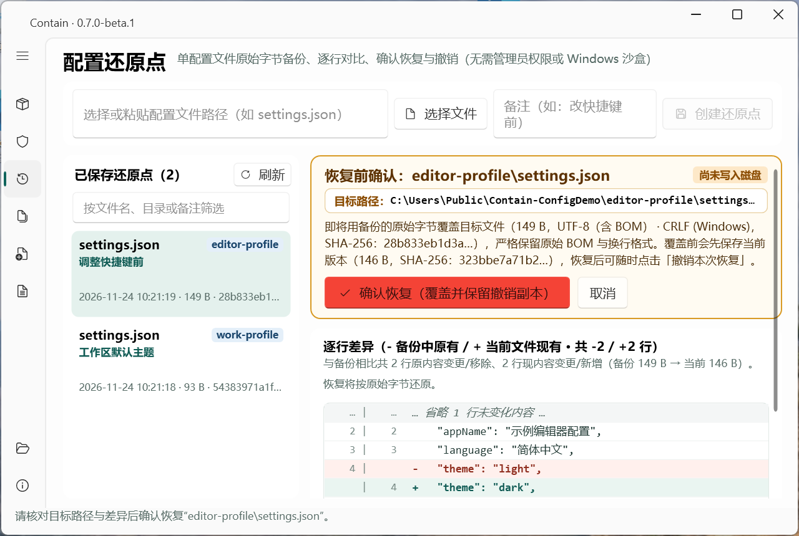

# Contain v0.7.0-beta.1「配置还原点」候选版验收记录

> 状态：**Windows x64 可安装试用候选版（`feat/config-restore-points` Draft PR，未合并、未打 Tag、未公开发布）**。当前公开稳定版为 `v0.6.0`。

## 1. 功能范围与设计边界

- **入口与权限**：桌面端左侧导航新增 **「配置还原点」**（`ActionId = ConfigRestorePoints`），完全在当前用户空间运行，**无需管理员权限，也不依赖 Windows Sandbox**。
- **单文件原始字节备份**：
  - 用户显式选择单个普通本地配置文件（如 `settings.json`、`settings.ini`），可填写可选备注（如“调整快捷键前”），点击「创建还原点」将原始字节落盘至 `%LOCALAPPDATA%\Contain\ConfigRestorePoints`（隔离测试时遵循 `CONTAIN_VIEWER_TEST_ROOT`），保存创建时间、文件名、目录与完整路径、字节数、SHA-256 及编码/换行识别信息。
  - 重启 Contain 后完整持久化；两个不同目录下的同名文件（如 `editor-profile\settings.json` 与 `work-profile\settings.json`）通过父目录徽章、完整目录副标题及独立完整路径严格区分，并支持按文件名、目录或备注筛选。
  - 第一版仅操作用户显式选中的普通本地文件：拒绝文件夹、设备路径与符号链接/重解析点，**不扫描整机，不修改注册表**。
- **状态核对与逐行差异**：
  - 选中还原点后只读核对目标文件并区分 **与备份一致**、**已变化**、**已缺失**、**读取失败** 与 **备份损坏** 五种状态。
  - 对可识别编码的文本（UTF-8 含/无 BOM、UTF-16 LE/BE 含 BOM）生成简洁逐行差异（`-` 备份中原有内容 / `+` 当前文件现有内容），并在仅 BOM 或换行符（CRLF/LF）发生变化时明确提示；编码无法可靠识别或二进制/大文件时退回展示字节数与 SHA-256。
  - 恢复与撤销始终按**原始字节**执行，严格保留原有 BOM 与换行格式。
- **恢复前确认、可撤销与失败保护**：
  - 点击「恢复」后先展示恢复前确认卡片（目标完整路径、即将执行的原始字节覆盖操作与差异），由用户明确点击「确认恢复」后再写入磁盘。
  - 覆盖前先原子持久化当前版本作为撤销副本，恢复后提供 **「撤销本次恢复」**；若用户停留在确认页期间目标文件被外部修改，首次点击「确认恢复」拦截写入、刷新差异并要求重新确认；若备份损坏、目标被占用或无写权限导致写入失败，则中止替换、清理临时文件并保住现有文件原样。

## 2. 候选构建身份

- **候选版本**：`0.7.0-beta.1`（PE / 程序集版本 `0.7.0.1`；采集核心沿用 `contain 0.3.2-beta.10`）
- **最终构建提交 SHA**：`ab8a1dce76ae5c7d7442544dbc316dd239205f97`（后续仅追加本验收文档与截图，不改产品代码与构建输入）
- **签名状态**：`NotSigned`（未做代码签名）

| 候选产物 | 大小（字节） | SHA-256 | 说明 |
| --- | ---: | --- | --- |
| `contain-0.7.0-beta.1-windows-x64.zip` | 71,440,881 | `5be8afad517fcc7453c3489dcd915077b85b4b5315fa3212c3268f41c1bc715e` | 便携解压即用桌面包（723 个载荷文件） |
| `Contain-Setup-0.7.0-beta.1-x64.exe` | 51,520,078 | `963e8688dc02103351c5b61eb64360b7a70bccc2ecaf90c4650ed320363e1700` | 当前用户最低权限安装器（Inno Setup `6.7.3`，`FileVersion=0.7.0.1`） |

## 3. 恢复前用户界面截图（真实 Windows 11 实拍）

下图在干净离线无沙箱 Windows 11 安装 `Contain-Setup-0.7.0-beta.1-x64.exe` 后重启实拍（`1280×860`），展示点击「恢复」后、尚未写入磁盘前用户看到的完整信息：左侧同名不同目录列表（`editor-profile` 与 `work-profile`）、右侧顶部「恢复前确认」卡片（目标路径、原始字节与 BOM/CRLF 保留说明、保留撤销副本提示与确认/取消按钮）以及紧邻下方的逐行差异（`"theme": "light"` → `"dark"`）：

## 4. 真实 Windows 11 实机验收结果（最终候选包）

测试全程通过 `CONTAIN_VIEWER_TEST_ROOT` 与独立测试目录隔离，未触碰个人记录库。

| 验收场景 | 被测产物 | 实测结果 |
| --- | --- | --- |
| 1. 中文 + UTF-8 BOM + CRLF 往返与重启持久化（备份 A → 改 B → 重启 → 差 → 恢复 A → 撤销回 B） | 最终 ZIP 解压版 + 离线 Setup 安装版 | **全部通过**：原始 A SHA-256 `28b833eb1d3a7d5e87fa87a8cb86556f488212572b0f834889030ea8134b26df`（149 B，UTF-8 含 BOM · CRLF），修改为 B SHA-256 `323bbe7a71b290e1360bb8eba99ae5a2b9853dc3b1af3ddb72a9197860a4c418`（146 B）；关闭 Contain（`exit 0`）并重启后还原点与备注「调整快捷键前」完好保留，逐行差异精确显示 `- "theme": "light",` / `+ "theme": "dark",`；确认恢复后磁盘实测 SHA-256 严格等于 A（BOM 与 CRLF 原样保留）；点击「撤销本次恢复」后磁盘实测 SHA-256 严格等于 B（BOM 与 CRLF 原样保留） |
| 2. 同名不同目录文件区分 | 最终 ZIP 解压版 | **通过**：同时为 `editor-profile\settings.json` 与 `secondary-profile\settings.json` 创建还原点，列表以目录徽章清晰区分；两份文件同时改动后仅恢复 `editor-profile\settings.json`（恢复至 A `28b833eb…`），核对 `secondary-profile\settings.json` 逐字节保持未触碰（`986e59a397fed3e418fbbcee2e3bbc3055072301dba755ce6d460a097ce4d137`） |
| 3. 确认期间外部编辑（B → C） | 最终 ZIP 解压版 | **通过**：打开针对 B 的恢复确认页后在外部将文件改为 C（`"theme": "high-contrast"`，`13092d879e43c34c267b0b71a05134e49be48aed29388727cb774bf5862b6bef`）；首次点击「确认恢复」阻止覆盖、保留 C 原样、弹出黄色警告并刷新差异指向 `high-contrast`；二次点击「确认恢复」恢复至 A；再点「撤销本次恢复」精准回到 C（而非过期 B） |
| 4. 写入失败与备份损坏保护 | 最终 ZIP 解压版 | **通过**：① 外部进程以 `FileShare.Read` 锁定目标文件禁止写入后点击「确认恢复」，界面显示「恢复失败：目标文件未能写入」，目标文件 C 逐字节完好（`13092d87…`）且目标目录残留 `0` 个临时文件；② 篡改备份二进制文件 1 字节后切回该还原点，状态立即显示「备份损坏」并禁用「恢复」按钮，目标文件保持完好（`986e59a3…`） |
| 5. 离线无沙箱 Setup 安装与卸载 | `Contain-Setup-0.7.0-beta.1-x64.exe` | **通过**：在断网无开发工具、未启用 Windows Sandbox 的干净 Windows 11 沙箱中普通用户静默安装（`DisplayVersion = 0.7.0-beta.1`），完成建点、重启对比、截图、恢复 A、撤销 B 及干净卸载（`exit 0`） |

## 5. 确定性模型与自动化回归（构建提交 `ab8a1dc`）

- `Contain.Desktop.Model.Tests`：**109 / 109 通过**（在 v0.6.0 的 99 项基础上新增 10 项配置还原点回归，覆盖 UTF-8 BOM/CRLF/中文往返、同名不同目录、缺失重建与撤销、无法识别编码/二进制原始字节恢复、仅 BOM/换行变化、确认期间外部修改、备份损坏/丢失、锁定与只读写入失败、恢复后外部修改中止撤销、目录/设备路径拒绝）。
- `cargo test -p contain-workflow --locked`：**55 / 55 通过**。
- `scripts/test-package-source-desktop.py`：**10 / 10 通过**。
- `scripts/check-fuzz-lock.py`、`cargo deny --locked check` 与全库卫生扫描：**全部通过**。
