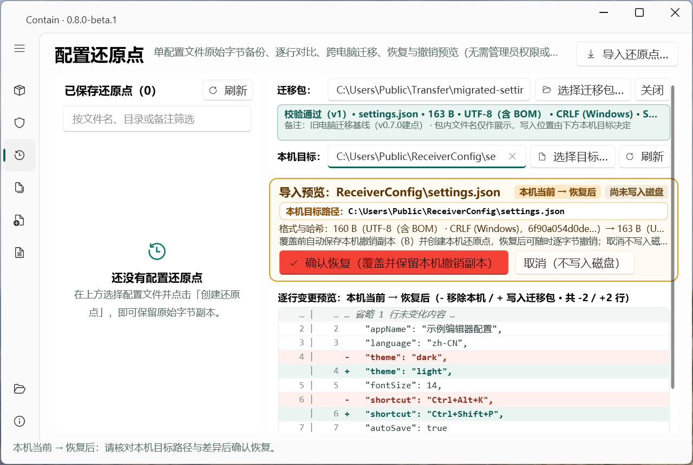

# Contain v0.8.0-beta.1「配置还原点迁移」验收记录

## 1. 候选包与构建身份

- **功能分支**：`feat/portable-config-restore-point`（基于已发布 `v0.7.0` 的 `main`）
- **构建提交 SHA**：`e23c24d2dbee462a2b4f8a09c84a30f0cd235eac`
- **产品版本**：`0.8.0-beta.1`（PE / AssemblyVersion：`0.8.0.1`；采集核心保持 `0.3.2-beta.10`）
- **发布状态**：本地候选包 + Draft PR（公开稳定版仍为 `v0.7.0`，本次不合并、不打标签、不公开发布）

| 候选产物 | 体积（字节） | SHA-256 |
| --- | ---: | --- |
| `Contain-Setup-0.8.0-beta.1-x64.exe` | 51,574,618 | `701f1ea49ddf9d1a62d436a3952db4e8cf2fe48704ba197e685ca3b549f83619` |
| `contain-0.8.0-beta.1-windows-x64.zip` | 71,506,401 | `d2b43e79008ce7072034b48028fbc6ba2c32de3180ec2c4049c62dab6f4d44f1` |
| `package-spec.json` | 34,413 | `08766daaf80a9ae8342e2b30f77cce5dc36a73b1a6b4a6633711e9520df1519c` |
| `identity.json` | 667 | `507f44ec7b01978be4955b6bc6b976aa0c5bea7a2c0dce8bcd1de0eb9bd58441` |
| `installer-receipt.json` | 917 | `5caf26ceb43d57aaee3dfe5d0df6309e660b9d7c5186b942ab3e9bf07141ef18` |
| `SHA256SUMS.txt`（自校验） | 476 | `9ed376ecf61d200c3254c98dfaa9754468293db1ed18937e5fb0e2492f57406d` |

> 说明：Windows 安装程序 `Contain-Setup-0.8.0-beta.1-x64.exe` 为未签名本地候选构建（`NotSigned`），默认按当前普通用户权限安装至 `%LOCALAPPDATA%\Programs\Contain`，配置还原点迁移全流程离线运行，无需管理员权限或 Windows Sandbox。

---

## 2. 迁移包格式与交互设计要点

### 2.1 单文件版本化迁移包（`.contain-config-point`）

- 顶层固定字段：`schema_version = 1`、`format = "contain-config-restore-point-package"`、`exported_at_utc`、`created_at_utc`、`display_file_name`、`note`、`byte_length`、`sha256`、`encoding_label`、`line_ending_label`、`payload_base64`。
- **源机脱敏隔离**：迁移包刻意排除 `target_path`、`target_directory`、`parent_folder_name`、`point_id` 及所有撤销记录，不携带旧电脑目录路径或主机状态。
- **文件名仅作展示**：`display_file_name` 仅用于导入校验摘要展示和文件选择器默认文件名，绝不自动决定接收机写入路径；包含路径分隔符或非法字符的包名在打开校验阶段即被拒绝。
- **完整性前置校验**：导入打开阶段即只读校验格式标识、版本号、Base64 载荷解码、字节长度和 SHA-256；任何未知格式、损坏内容、长度不符或摘要篡改均在接触本机目标文件前以清晰中文错误拦截。

### 2.2 「导出还原点…」与「另存原副本…」的明确区分

- **「导出还原点…」**（详情头部主操作区）：始终导出所选还原点**建点时保存的原始字节备份（A）**，即使源机磁盘上的文件已被改为 C 或已删除仍可导出 A；打开导出确认卡片时明确显示备份版本信息与隐私提醒（提示配置文件可能包含令牌、账号、密钥或私人路径，Contain 原样保留原始字节以保证恢复逐字节一致，且迁移包不含源机目录路径或撤销记录）。
- **「另存原副本…」**（恢复冲突 / 中断恢复核对卡片与原副本只读预览）：用于救回恢复操作覆盖前的本机原始副本（B），按钮工具提示与界面文案明确区分两者用途。

### 2.3 复用 v0.7.0 恢复、撤销、并发锁与中断核对引擎

- 接收机确认导入恢复时，在本机用户数据目录创建全新的本地还原点身份（新 `point_id`，绑定到接收机的本机目标路径），随后复用 v0.7.0 的内核级跨进程目标写锁与分阶段崩溃安全核心执行写入：
  - 目标文件存在（B）：覆盖前先保存并校验 B 副本，写入原始字节 A（保留 UTF-8 BOM 与 CRLF），恢复后支持撤销预览并逐字节撤回 B；
  - 目标文件缺失：预览阶段明确展示将新建的完整路径，确认后创建 A，撤销预览预告「确认撤销（移除重建文件）」，确认后干净删除新建文件；
  - 确认期间目标被外部修改：拦截本次写入、保留外部新改动并刷新「本机当前 → 恢复后」差异，再次确认后可正常写入并撤销回最新覆盖前版本；
  - 双窗口并发或操作中断：沿用 v0.7.0 跨进程锁阻塞与只读启动核对流程。

---

## 3. 自动化受控测试（代码基线 `e23c24d`）

| 检查项 | 结果 | 覆盖重点 |
| --- | --- | --- |
| `dotnet build Contain.Desktop / Controls.Tests / Tests -c Release` | 0 警告 / 0 错误 | 桌面端、模型层与全部测试工程 Release 编译通过 |
| `Contain.Desktop.Model.Tests` | **133 / 133 通过** | 含 7 项 `v0.8.0-beta.1` 新增迁移测试：源改 C/删除后导出 A 且不含源路径、异路径导入预览/取消/恢复/撤销、缺失目标新建与撤销移除、8 类异常包拒绝、确认期间外部修改保护、复用跨进程锁与中断恢复核对、二进制载荷与同内容拦截 |
| `scripts/test-package-source-desktop.py` | **10 / 10 通过** | `0.8.0-beta.1` 打包契约与窗口标题绑定校验 |
| `scripts/check-fuzz-lock.py` | **通过** | fuzz 与生产依赖锁一致性校验 |
| `cargo test -p contain-workflow --locked` | **55 / 55 通过** | 4 项单元测试 + 51 项集成测试 |
| `cargo deny --locked check` | **通过** | advisories / bans / licenses / sources 全绿 |

---

## 4. 最终候选包跨环境真实 GUI 验收

> 以下结果均基于最终候选产物（`contain-0.8.0-beta.1-windows-x64.zip` 与 `Contain-Setup-0.8.0-beta.1-x64.exe`，构建提交 `e23c24d`）在隔离源机与独立断网无 Windows Sandbox 接收机上通过真实桌面 GUI 端到端实测产出，完整机器回执保存在本地候选目录 `v080b1-cross-env-acceptance-receipt.json`。

### 4.1 关键配置版本与校验摘要汇总

| 对象 | 编码与换行 | 字节数 | SHA-256 |
| --- | --- | ---: | --- |
| 源机建点备份 **A**（`theme: light`） | UTF-8（含 BOM）· CRLF | 163 | `114195afa1ce1ca64b71debd5f41014da1cbc2f99f6dcd1cd154334caaf6343a` |
| 源机后续修改版本 **C**（`theme: high-contrast`） | UTF-8（含 BOM）· CRLF | 171 | `d82e48689fa3ea21328f1dd26dedce7daa1b1ebb34fcfe78338fd83e67658f25` |
| 导出的迁移包 `.contain-config-point`（v1） | UTF-8 JSON | — | `f46507bf5bbda39a3600a957fabf4fa538579004819b57bb150572df009602f5` |
| 接收机原配置 **B**（`theme: dark`） | UTF-8（含 BOM）· CRLF | 160 | `6f90a054d0de67e3280ece724b5f5bbd62633c65012b68d85c3c4f80e0ceafda` |
| 接收机确认期间外部改写 **B2**（`theme: solarized`） | UTF-8（含 BOM）· CRLF | 161 | `e99e25515f0b589ebec15572407e2efb90a4df3b3d70939bf787fcb994dc9c2e` |

### 4.2 源机端实测（公开 `v0.7.0` 建点 → 改源 C / 删源文件 → 最终 `v0.8.0-beta.1` 导出）

1. 使用已公开发布的 **`v0.7.0`**（`FileVersion=0.7.0.0`）在隔离数据目录中为中文 + UTF-8 BOM + CRLF 合成配置文件 `settings.json`（版本 **A**）与辅助文件 `secondary.ini` 创建配置还原点。
2. 关闭 `v0.7.0` 后，将源机磁盘上的 `settings.json` 修改为版本 **C**，并将 `secondary.ini` 从磁盘删除。
3. 使用最终候选 **`v0.8.0-beta.1`**（`FileVersion=0.8.0.1`）打开同一隔离数据目录：
   - 正确加载 `v0.7.0` 已有还原点，将 `settings.json` 识别为「已变化」，点击「导出还原点…」展示备份版本摘要与完整隐私提醒，导出迁移包 `migrated-settings.contain-config-point`。
   - 校验迁移包解码后原始字节 SHA-256 严格等于 **A**（`114195af…`），且迁移包 JSON 中不含任何源机目录路径、`point_id` 或撤销记录；源机磁盘 `settings.json` 保持 **C**（`d82e4868…`）。
   - 对已删除的 `secondary.ini`（状态「已缺失」）同样成功导出建点时原始字节（`0fedf7ca…`），且未重新创建已删除源文件。

### 4.3 接收机端实测（独立断网、无 Windows Sandbox 的 Windows 11 Build 26100）

- **接收机环境实测核验**：`Microsoft Windows 11 企业版 (Build 26100)`，`wsb_present = false`（无 Windows Sandbox 命令），`offline_verified = true`（`default_route_count = 0`，完全断网）。
- **正常安装与版本核验**：运行最终 `Contain-Setup-0.8.0-beta.1-x64.exe`（退出码 `0`），安装在当前用户目录，核验 `FileVersion = 0.8.0.1`、`ProductVersion = 0.8.0-beta.1+e23c24d...`、卸载注册表 `DisplayVersion = 0.8.0-beta.1`。
- **真实 GUI 逐项实测结果**：
  1. **异常迁移包拦截**：依次打开未知格式（`unknown-foreign-package`）、损坏 JSON（截断文件）与长度不符（声明 183 字节、实解 163 字节）三个异常包，界面均显示明确中文错误提示且不提供确认按钮，接收机文件 B 哈希未变动。
  2. **合法迁移包导入与 B → A 预览截图**：打开从源机导出的迁移包，校验通过并展示 `settings.json`、163 B、UTF-8（含 BOM）、CRLF、SHA-256 与备注；选择接收机异路径目标 `C:\Users\Public\ReceiverConfig\settings.json`（当前内容为 B），界面明确显示「本机当前 → 恢复后」、完整目标路径、`- "theme": "dark"` / `+ "theme": "light"` 及 `- "shortcut": "Ctrl+Alt+K"` / `+ "shortcut": "Ctrl+Shift+P"` 逐行差异与主确认按钮。150% 高 DPI 下在 `1280×860` 窗口中目标路径、操作方向、确认按钮与红绿逐行差异全部同屏可见（`all_key_elements_visible_simultaneously = true`）：

  3. **取消不写盘**：点击「取消（不写入磁盘）」后，目标文件 SHA-256 仍严格等于 **B**（`6f90a054…`），不生成本地还原点或撤销记录。
  4. **主路径迁移（B → A → 撤销 → B）**：重新预览并确认恢复后，目标文件 SHA-256 变为 **A**（`114195af…`，实测保留 UTF-8 BOM + CRLF），本地新建绑定接收机路径的还原点并出现撤销栏；点击撤销进入「当前文件 → 撤销后」预览并确认后，目标文件逐字节恢复为 **B**（`6f90a054…`）。
  5. **确认期间外部修改保护（B → B2）**：预览 B 期间在外部将目标文件改写为 **B2**（`theme: solarized`），点击确认恢复后 Contain 拦截写入、完整保住 **B2**（`e99e2551…`）、弹出外部修改提醒并自动将差异刷新为 `- "theme": "solarized"` / `+ "theme": "light"`；再次确认写入 **A**，随后撤销精确回到 **B2**（`e99e2551…`）。
  6. **目标文件缺失（新建 A → 撤销移除）**：选择本机尚不存在的完整路径 `C:\Users\Public\ReceiverNewProfile\editor\settings.json`，预览显示「本机当前（缺失） → 恢复后（将新建）」与完整新建路径；确认后成功新建文件且 SHA-256 严格等于 **A**；撤销预览按钮预告「确认撤销（移除重建文件）」，确认后文件被干净删除。
  7. **干净卸载与源机终态复核**：关闭窗口后执行卸载器（退出码 `0`），安装目录与卸载注册表项清理干净；复核源机原 `settings.json` 仍严格保持 **C**（`d82e4868…`）。
